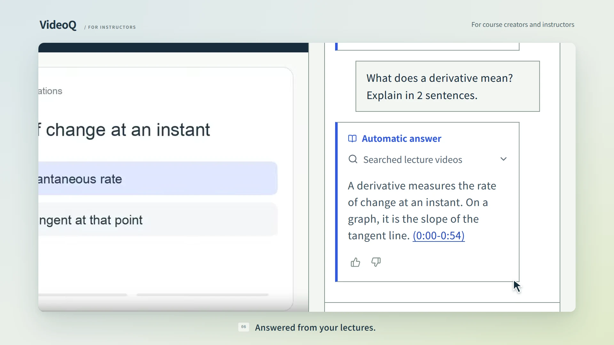

# VideoQ

**Automatic answers to student questions, from your lecture videos.**

VideoQ is for course creators, instructors, and training owners. Upload recordings or import YouTube lectures, group them into a course, and share it. Students ask in their own words and get an answer based on the course, with a timestamp that jumps to the explanation.

Answers use the course owner's allowance. Owners can review question history and feedback to see where students need help.

**[Try VideoQ](https://videoq.jp/en/) · [No-signup demo](https://videoq.jp/en/try) · [Documentation](https://docs.videoq.jp/) · [Quick start](#quick-start)**

## Watch the demo

[](https://videoq.jp/demo/provider-demo-en.mp4?v=4)

**[▶ Play the English demo (30 seconds)](https://videoq.jp/demo/provider-demo-en.mp4?v=4)** · [Watch on the website with captions](https://videoq.jp/en/#landing-demo)

An instructor uploads a lecture and shares the course, a student asks a question and plays the cited moment, and the instructor finds that question in the conversation history.

*Recreated walkthrough using real course data and a captured AI answer; the opening is an illustration, and the English edit translates the interface, question, and answer. Waiting times have been shortened.*

## Features

- **Automatic answers across a course** — Students ask in their own words and get answers drawn from your lecture videos.
- **Check the source** — Follow timestamps from an answer to the relevant video scenes and review them in context.
- **Bring your own material** — Upload MP4, MOV, WebM, and other supported formats with a selectable spoken language, or import YouTube transcripts using your SearchAPI key.
- **Organize and share** — Group videos into courses, label them with tags, and give students access through share links (no login needed) or email invitations.
- **Review student questions** — Explore question history, answer feedback, analytics, and CSV exports.
- **Use Japanese or English** — Switch between Japanese and English interfaces.
- **Connect MCP clients** — Use Claude Code and other compatible tools to manage videos and courses or inspect question history through OAuth or API keys.
- **Manage usage** — Configure user quotas, storage limits, reindex jobs, and optional Stripe subscriptions.

> **New to the team?** Start with the [developer documentation](docs/README.md): [local setup](docs/getting-started/local-setup.md), [first walkthrough](docs/getting-started/first-walkthrough.md), and [codebase tour](docs/getting-started/codebase.md). Architecture and design references are also available there.

## Quick Start

Choose the environment you want to run:

| Goal | Start here |
|---|---|
| Try VideoQ without installing it | [Hosted demo](https://videoq.jp/en/try) |
| Prepare a lab RTX 4090 with Ansible and manage applications with Argo CD | [Lab GitOps setup (in development)](docs/guides/lab-gitops.md) |
| Evaluate on-prem on one Linux server | [Single-server installation](docs/guides/on-premises-single-server.md) |
| Use an existing Kubernetes cluster and site-managed services | [Kubernetes installation](docs/guides/on-premises.md) |
| Edit the application on your computer | [Local development setup](docs/getting-started/local-setup.md) |

For an initial on-prem evaluation, start with one server. The installer supplies
PostgreSQL, object storage and a persistent queue, generates credentials, and
creates the initial administrator. Use Docker Engine, Compose and Python 3.9+;
application images come from a [verified release](docs/guides/on-premises-releases.md).

After obtaining `verified-images.json`, run from the repository root:

```sh
python3 scripts/onprem/videoq.py --directory /secure/videoq-server install \
  --images /secure/videoq-release/verified-images.json \
  --url https://videoq.example.edu --storage-url https://s3.example.edu \
  --username site_admin --email admin@example.com
```

The [single-server guide](docs/guides/on-premises-single-server.md) covers URL/TLS
setup, diagnosis, backup, updates and recovery. Validate your own videos and AI
services on this server before deciding whether to split services across hosts.

For development, follow the [local setup guide](docs/getting-started/local-setup.md)
from environment configuration through account activation. The root
`docker-compose.yml` builds a Wrangler development stack; its signup and account
promotion flow differs from the production on-prem installer.

### One RTX 4090: lab GitOps deployment

Use [Ansible for initial preparation and Argo CD for application deployment](docs/guides/lab-gitops.md).
Keep lab configuration in an internal Forgejo/GitLab repository and enable the
[verified automatic release follower](docs/guides/lab-auto-update.md) after initial acceptance.
The GPU profile shares one24GB RTX4090 between GPT-OSS20B, EmbeddingGemma2 and Whisper,
using unchanged digest-pinned upstream vLLM images. No engine build is needed.

### Optional: reduce costs with local AI

[Local inference](docs/guides/local-inference.md) explains private chat,
embeddings and transcription, including [Mac development with whisper.cpp](docs/guides/local-inference.md#mac-development-with-whispercpp).
The single-server installer connects to existing inference services; the
[inference chart](charts/videoq-inference/README.md) provisions Kubernetes services.
For hosted AI identity and operational checks, see the
[provider runbook](docs/operations/openai-transcription.md).

## Architecture

For the research behind the AI pipeline, see [AI methods and references](docs/reference/ai-references.md) ([Japanese translation](apps/docs/i18n/ja/docusaurus-plugin-content-docs/current/reference/ai-references.md)) and the reusable [BibTeX bibliography](docs/reference/ai-references.bib). It maps RAG, ReAct, Whisper, Otsu-inspired subtitle splitting, VideoSeek-inspired navigation, and the configured models to their original papers or official sources.

The hosted service uses the following stack. On-prem deployments use the Node.js
runtime and private backing services described below.

| Layer | Stack |
|---|---|
| Frontend | React 19, TypeScript, Vite, TanStack Query → Cloudflare Workers Static Assets |
| Web API | Hono + tRPC, Zod, Drizzle ORM → Cloudflare Workers |
| Authentication | Better Auth cookie sessions, API keys, OAuth provider; optional Google sign-in |
| Async jobs | Python worker → Amazon SQS / AWS Lambda |
| Database | Neon PostgreSQL + pgvector through Hyperdrive (local: PostgreSQL 17 + pgvector) |
| Object storage | Cloudflare R2 (local: Garage) |
| Edge state | Durable Objects (rate limits, task recovery scheduling, and chat execution) |
| External services | OpenRouter (hosted AI) / optional local AI, SearchAPI for YouTube transcripts, Mailgun email, Stripe billing |

Locally, `docker compose` runs Postgres, Garage, ElasticMQ, the Hono API (`wrangler dev`), the Python worker, a static frontend build, and a Caddy gateway on port 80.

For a single Linux server, use the [installer guide](docs/guides/on-premises-single-server.md).
For on-prem Kubernetes, the [Helm chart](charts/videoq/README.md) deploys a production
Node.js API, static web and Python workers against operator-provided PostgreSQL,
S3 storage, a persistent SQS-compatible queue and configured inference endpoints.
See the [on-prem guide](docs/guides/on-premises.md) for the runtime differences.

```text
Browser → Caddy → React (nginx)
               → Hono API → PostgreSQL / ElasticMQ (SQS)
Browser → Garage (signed uploads)          ↓
                              Python worker → PostgreSQL / Garage
```

The SPA shares the typed `/api/trpc` contract in `packages/trpc`. Hono also serves Better Auth, MCP, chat streaming, media, CSV exports, and the Stripe webhook. Browser authentication uses cookies; MCP uses API keys or OAuth access tokens.

Async processing runs transcription (saved interval by interval for uploaded files) → scene indexing, plus optional visual caches for uploads. Jobs are recorded in a database outbox and delivered to SQS, and the worker tracks job IDs to handle retries. In cloud and Wrangler development deployments, the `TASK_SCHEDULER` Durable Object schedules recovery for pending deliveries and abandoned uploads. A daily `17 3 * * *` UTC cron performs retention cleanup and recovery; there is no five-minute polling cron.

Package READMEs: [`apps/`](apps/README.md) · [`apps/api/`](apps/api/README.md) · [`apps/web/`](apps/web/README.md) · [`apps/worker/`](apps/worker/README.md) · [`apps/docs/`](apps/docs/README.md) · [`apps/demo-video/`](apps/demo-video/README.md) · [`packages/trpc/`](packages/trpc/README.md)

## Development

See [the workflow map](.github/WORKFLOWS.md) for CI, deployment, automatic dependency updates, and operations checks.

Run npm commands from the repository root. Dependencies for `apps/api`, `apps/demo-video`, `apps/docs`, `apps/web`, and `packages/trpc` share the root lockfile.

```bash
npm ci
npm run typecheck
npm run lint
npm test
npm run build
```

`npm run lint` checks all five TypeScript workspaces. Type checks and builds use native TypeScript 7; ESLint uses the official TypeScript 6 compatibility API. Run `npm run test:lint` to verify the compiler and lint setup.

`npm test` runs API unit / Workers runtime tests and frontend tests. API database integration tests additionally require `QUOTA_TEST_DATABASE_URL` pointing to a test PostgreSQL instance with pgvector and permission to create test databases.

### Documentation site

Read the published docs in [English](https://docs.videoq.jp/) or [Japanese](https://docs.videoq.jp/ja/).

The Docusaurus site reads English Markdown from [`docs/`](docs/README.md) and Japanese
translations from `apps/docs/i18n/ja/docusaurus-plugin-content-docs/current/`.
English is the default at `/`; the header language menu switches to Japanese at `/ja/`.
Both languages include Mermaid diagrams and local full-text search.
Documentation changes merged into `main` are automatically published by
[CD](.github/workflows/cd.yml) after CI succeeds.

```bash
npm run dev:docs      # http://localhost:3001
npm run dev:docs -- --locale ja  # Japanese only: http://localhost:3001/ja/
npm run build:docs    # Both languages: apps/docs/build
npm run preview:docs  # Preview the build, including search, on port 3001
npm run deploy:docs   # Build and publish the current working tree to docs.videoq.jp
```

The development server runs one language at a time. Build and preview to check
the language switcher and search; search indexes are generated during the build. See
[`apps/docs/README.md`](apps/docs/README.md) for editing and hosting settings.

### Frontend and API on the host

For frontend-only work against the Compose API:

```bash
VITE_API_URL=/api VITE_USE_S3_STORAGE=true npm run dev:web
# http://localhost:3000; Vite proxies /api to 127.0.0.1:8787
```

To also run Hono outside Docker, stop the Compose API to release port 8787, then prepare Wrangler's variables:

```bash
docker compose stop api
cp apps/api/.dev.vars.example apps/api/.dev.vars
```

Set `BETTER_AUTH_SECRET`, `USER_SECRET_ENCRYPTION_KEY`, and `OPENROUTER_API_KEY` in `apps/api/.dev.vars`. For the hosted setup above, also set:

```dotenv
BETTER_AUTH_URL=http://localhost:3000
FRONTEND_URL=http://localhost:3000
OAUTH_ISSUER_URL=http://localhost:3000
OPENAI_BASE_URL=https://openrouter.ai/api/v1
LLM_MODEL=openai/gpt-6-luna
EMBEDDING_MODEL=openai/text-embedding-3-small
```

Keep the Garage / ElasticMQ settings from `.dev.vars.example`, use the same user-secret encryption key as the Python worker, then run `npm run dev:api` in another terminal. Wrangler's local Hyperdrive connection targets `localhost:55432`; override it if you changed the database credentials. The Compose dependencies and Python worker continue running.

Restarting the Compose API regenerates `.dev.vars`, so keep host-only configuration separately if you switch between these workflows. MCP OAuth discovery additionally needs `/.well-known/*` forwarding, as shown in [`Caddyfile.dev`](Caddyfile.dev); Vite currently proxies `/api`, `/health`, and `/ready` only.

### Database changes

Edit [`apps/api/src/db/schema/`](apps/api/src/db/schema/), then generate and verify migrations:

```bash
npm run db:generate -- --name describe_the_schema_change
npm run db:check
npm run db:verify
npm run db:migrate
```

Do not hand-edit generated DDL SQL, snapshots, or the journal. Data-only backfills use `npm run db:generate:custom -- --name describe_the_data_change` and must start with `-- drizzle-kit:custom`; custom migrations must not contain DDL. `db:verify` checks migration provenance, and the API database integration tests apply the full migration history to an empty database.

`db:migrate` uses `DATABASE_URL` when exported, otherwise the local `postgres:postgres` connection on port 55432. Root `.env` values are not automatically loaded by Drizzle Kit. See the [API README](apps/api/README.md) for details.

### Python worker

```bash
cd apps/worker
python3 -m venv .venv
source .venv/bin/activate
pip install -e ".[dev]"
python -m pytest tests/ -q
```

PostgreSQL integration tests additionally use `DATABASE_URL`. Running transcription outside Docker requires FFmpeg and the database, storage, queue, and AI environment settings described in the [worker README](apps/worker/README.md).

### Dependency updates

[Dependabot](.github/dependabot.yml) checks for version updates every Monday at
09:00 Asia/Tokyo. It covers the root npm workspaces, the Python worker's
`pyproject.toml` / `uv.lock`, GitHub Actions, Dockerfiles, Docker Compose,
Terraform (including `infra/bootstrap`), and the optional `whisper.cpp` submodule.
[Runtime Updates](.github/RUNTIME-UPDATES.md) separately checks daily for Node.js,
Python, npm, pip, and uv releases.

Dependabot alerts and security updates are separate repository settings under
**Settings → Advanced Security**; keep both enabled. After CI succeeds,
[Dependency Automation](.github/dependency-automation.md) verifies each update's
origin and files, then queues eligible Dependabot major/minor/patch updates and
current-line runtime PRs in GitHub Merge Queue. It can send repairable CI failures
to an isolated Claude worker. New runtime lines and PRs with unverified changes
require human review. Terraform provider minor/patch updates also apply
automatically after merge; ordinary infrastructure changes and provider majors
retain production approval. CI and production worker builds install hash-verified
binary dependencies from `uv.lock`.

## Deployment

For on-prem deployments, use the [single-server guide](docs/guides/on-premises-single-server.md)
or [Kubernetes guide](docs/guides/on-premises.md). Both use production Node.js images
and administrator-issued accounts.

### Hosted service

The hosted topology is Cloudflare Workers (separate frontend, API, and docs) + Hyperdrive, Neon PostgreSQL, Cloudflare R2, and an ARM64 Python Lambda consuming SQS. Follow [`infra/DEPLOY.md`](infra/DEPLOY.md) for provisioning, secrets, migrations, CORS, and deployment checks.

- Frontend: `videoq-web` Worker + Static Assets, configured in `apps/web/wrangler.jsonc`; GitHub Actions CD deploys after successful main CI.
- API and worker: [GitHub Actions CD](.github/workflows/cd.yml) applies database migrations before deployment. Terraform in `infra/` manages AWS resources.
- Authentication: configure `BETTER_AUTH_SECRET`, public URLs, and Mailgun for verification / invitation email; Google sign-in is optional.
- Billing: configure Stripe keys, products, and the webhook using the [billing setup](docs/billing/stripe-dashboard.md).

### HTTPS with Docker Compose

Caddy accepts a public hostname through `SITE_ADDRESS`, but the checked-in stack runs `wrangler dev` with development settings and signs uploads for `http://127.0.0.1:9000`. Setting a domain in `.env` alone does not configure a public deployment: authentication origins, CORS, API variable forwarding, secrets, and a browser-accessible HTTPS storage endpoint also need configuration. Use the [single-server installer](docs/guides/on-premises-single-server.md) for on-prem hosting, or the production deployment guide above for the cloud setup.

## MCP (Model Context Protocol) Integration

VideoQ exposes a remote MCP server at `/api/mcp` (Streamable HTTP via `@hono/mcp`). Connect a compatible client using the endpoint URL and an API key, or use the OAuth authorization flow. Older clients can use the `mcp-remote` bridge below.

> 🛡️ **Permission policy:** Read tools accept `read_only` API keys or OAuth tokens with `videoq.read`. Video upload and course management tools require an `all` API key or the OAuth `videoq.write` scope. The server sets each API key's permissions from the type selected at creation. Sending RAG chat questions is intentionally excluded from MCP.

### Available tools

VideoQ exposes 7 read-only tools and 5 write tools. The MCP metadata and tests enforce
that split, including each tool's input/output schema and safety annotations.

| Tool | Purpose |
|---|---|
| `list_videos` / `get_video` | List videos and view details (with opt-in, bounded transcript chunks) |
| `request_video_upload` / `confirm_video_upload` | Upload a local video through a signed object-storage URL and start processing |
| `create_youtube_video` | Register and import a YouTube lecture URL |
| `list_courses` / `get_course` | List courses and their member videos |
| `create_course` | Create a course |
| `add_video_to_course` | Add an uploaded video to a course |
| `list_tags` | List tags |
| `get_chat_history` | Chat history for a course (with feedback) |
| `get_chat_analytics` | Question counts, period, daily time series, feedback aggregates |

List tools support `limit` / `offset` pagination. General lists default to 20 and allow at most 100 items; chat history defaults to 10 and allows at most 25. `get_course` paginates member videos separately with `video_limit` / `video_offset`. `get_video` omits the transcript by default; request bounded chunks with `include_transcript`, `transcript_offset`, and `transcript_limit`.

The three create/reserve tools (`request_video_upload`, `create_youtube_video`, and `create_course`) require an `idempotency_key`. Generate one stable value per logical operation and reuse it only when retrying the same arguments. Upload confirmation and course membership addition are also safe to retry.

### Setup

#### Step 1: Issue an integration API key

Log in to VideoQ and issue a `vq_...` key from **Settings → Integration API Keys**, then copy it. Select `all` to upload videos or manage courses; `read_only` is enough for analytics.

#### Step 2: Register the endpoint with your MCP client

The endpoint URL is your VideoQ host followed by `/api/mcp` — for example, `http://localhost/api/mcp` for a local Docker setup or `https://your-domain.example.com/api/mcp` in production. Authenticate with `Authorization: Bearer vq_...` (or the equivalent `X-API-Key` header).

For **Claude Code**:

```bash
claude mcp add --transport http videoq https://your-domain.example.com/api/mcp \
  --header "Authorization: Bearer vq_xxxxxxxxxxxxxxxx"
```

For **Claude Desktop / claude.ai (built-in connector, OAuth 2.1)**, paste just the MCP URL into **Settings → Connectors → Add custom connector** and approve the consent screen. No API key needed — VideoQ implements OAuth 2.1 + Dynamic Client Registration (RFC 7591) per the MCP Authorization spec.

```
https://your-domain.example.com/api/mcp
```

The client discovers the authorization server through `/.well-known/oauth-protected-resource/api/mcp` and `/.well-known/oauth-authorization-server/api/auth`, registers at `/api/auth/oauth2/register`, and runs the authorization-code flow with PKCE. The authorization server issuer is `{public-origin}/api/auth`, and the protected resource is `{public-origin}/api/mcp`. VideoQ enforces `videoq.read` / `videoq.write` scopes. Revoke grants from **Settings → Connected Apps**.

For your own production instance, complete the [deployment setup](infra/DEPLOY.md). Set the API runtime URL variables to the public HTTPS origin:

```dotenv
BETTER_AUTH_URL=https://videoq.example.com
FRONTEND_URL=https://videoq.example.com
OAUTH_ISSUER_URL=https://videoq.example.com
```

After deployment, confirm that the MCP endpoint and OAuth metadata are reachable before registering the connector (an unauthenticated MCP request can return `401`):

```text
https://videoq.example.com/api/mcp
https://videoq.example.com/.well-known/oauth-authorization-server/api/auth
https://videoq.example.com/.well-known/oauth-protected-resource/api/mcp
```

If you need to fall back to the `mcp-remote` bridge for an older client, configure it with your API key instead:

```json
{
  "mcpServers": {
    "videoq": {
      "command": "npx",
      "args": [
        "mcp-remote",
        "https://your-domain.example.com/api/mcp",
        "--header",
        "Authorization: Bearer vq_xxxxxxxxxxxxxxxx"
      ]
    }
  }
}
```

Config file locations:

- macOS: `~/Library/Application Support/Claude/claude_desktop_config.json`
- Windows: `%APPDATA%\Claude\claude_desktop_config.json`

**Cursor** and other Streamable HTTP-capable clients use the same URL + header pattern.

#### Step 3: Verify

Restart the client and confirm that the MCP server appears as `videoq`. Try prompts like "Create a course named Physics", "Upload lecture.mp4 and add it to the Physics course", or "Analyze the chat history for course 1".

For a local file, Claude Code generates an idempotency key, calls `request_video_upload`, uploads the file with an HTTP `PUT` using the returned URL and required headers, and then calls `confirm_video_upload`. The video bytes do not pass through the Worker or MCP JSON payload. Retrying the prepare call after confirmation returns the current video state without minting an overwrite-capable PUT URL.

### Troubleshooting

- **`401 Unauthorized`** → The API key (or OAuth token) is missing, malformed, or revoked. Reissue from Settings and update the header, or re-approve the OAuth connector.
- **`404 Not Found`** → The URL is wrong. Confirm the host and the `/api/mcp` path.
- **OAuth connector cannot discover the server** → Confirm that `https://<host>/.well-known/oauth-authorization-server/api/auth` and `https://<host>/.well-known/oauth-protected-resource/api/mcp` return JSON. Reverse proxies must forward `/.well-known/*` to Hono, and metadata must advertise the public origin.

## Repository layout

```text
apps/api/        Hono + tRPC on Cloudflare Workers (or Node.js on-prem)
apps/web/        React SPA
apps/worker/     Python async pipeline (SQS / Lambda)
apps/docs/       Documentation site and Japanese translations
apps/demo-video/ Remotion demo films
apps/inference/  Private speech gateway and engine images for on-prem
packages/trpc/   Shared Hono ↔ React tRPC router and contract
package.json     npm workspace root
scripts/onprem/  Single-server installer and acceptance checks
charts/          Helm charts for on-prem application and inference
infra/           Terraform (SQS, Lambda, ECR, IAM) + deploy notes
docs/            Architecture, design, and operations docs
assets/brand/    Brand masters
whisper.cpp/     Optional local transcription server (Git submodule)
.github/workflows/   CI, CD, Terraform, Cloudflare resource management
docker-compose.yml   Local full stack
Caddyfile.dev        Local gateway and protocol routing
```

## Contributing

Found a bug or want to add a feature? Contributions are welcome.

1. Fork the repository
2. Create a feature branch
3. Make your changes
4. Add tests as needed
5. Submit a pull request

For frontend UI changes, follow the [Storybook change and review workflow](apps/web/STORYBOOK.md) to update the relevant stories and share verification results in your PR.

## Citation

- Hironobu Fujiyoshi. "Using Generative AI in Education in an Era of Living with AI: 'Fujiyoshi AI Teacher'" (title translated from Japanese). Information Processing Society of Japan, *Information Processing*, Vol.66, No.11 (2025).
  - [https://ipsj.ixsq.nii.ac.jp/records/2004788](https://ipsj.ixsq.nii.ac.jp/records/2004788)

## License

See the [LICENSE](LICENSE) file for details.
