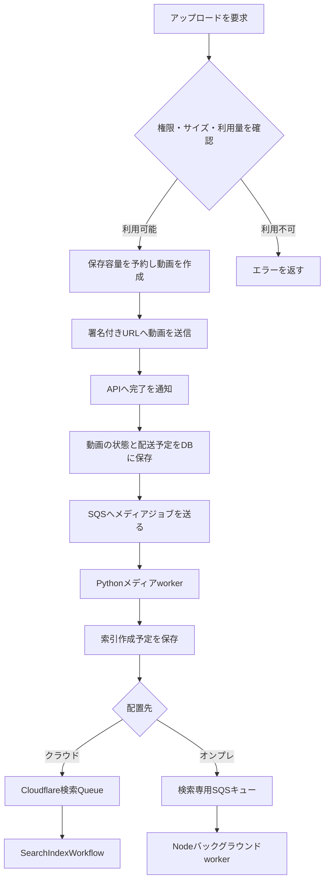
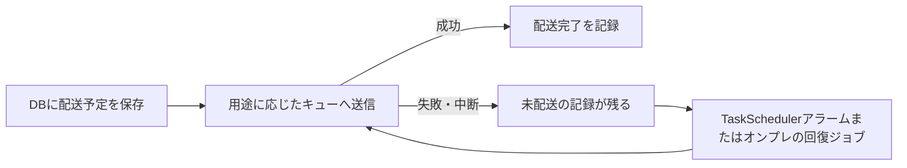

# ジョブの配送と回復

動画を処理するには、「DBに動画を保存する」と「workerへ仕事を届ける」の両方が必要です。途中でAPIやネットワークが止まっても仕事を取りこぼさないように、配送予定をDBにも記録します。

## アップロードからジョブへ

署名付きURLは、対象ファイルを送るための期限付きURLです。ファイル本体はストレージへ送り、APIは権限や状態を管理します。

## 配送に失敗したら

`external_tasks` は配送予定を保存する **outbox** です。業務データと同じトランザクションで記録するため、「DB更新だけ完了し、仕事を忘れる」状態から回復できます。

通常はAPIの処理中に配送します。クラウドでは `TASK_SCHEDULER` のアラーム、オンプレでは保守ジョブが失敗や中断した配送を回復します。配送完了はworkerの処理完了とは別です。アカウントジョブも同じoutboxを使い、アカウント用キューへ送ります。

SQSの配送では、10秒の期限付きHTTPリクエストを1回送ります。クラウドの検索・アカウント処理はCloudflare Queueのバインディングを使います。配送に失敗したらoutboxへ返し、次の試行時刻を保存して同じ `job_id` で再配送します。検索キューの配送確認は永続ワークフローの作成を意味し、索引作成やベクトルの検索準備完了はその後に確認します。

## workerが途中で止まったら

SQSとCloudflare Queuesは同じ仕事を再配送することがあります。Pythonのメディア処理とTypeScriptのバックグラウンド処理は、`job_executions` に `job_id` ごとの実行記録を持ちます。

- 完了済みのジョブなら、同じ処理を繰り返しません。
- 実行中は期限付きの実行権を取得します。
- 処理が停止した場合は、期限切れ後に再実行できるようにします。
- 後続ジョブのIDは親ジョブから決定し、再試行で別の仕事が増えることを防ぎます。

この仕組みだけで、任意の外部API操作が自動的に一度だけ実行されるわけではありません。処理本体でも再実行時の挙動を設計します。

## 調べる場所

| 見たいこと | 実装 |
|---|---|
| APIの配送予定と送信 | [external-tasks.ts](https://github.com/videoq-jp/videoq/blob/main/apps/api/src/lib/external-tasks.ts) |
| 回復の予約 | [task-scheduler.ts](https://github.com/videoq-jp/videoq/blob/main/apps/api/src/durable-objects/task-scheduler.ts) |
| メディアの実行権・重複対策 | [job_execution.py](https://github.com/videoq-jp/videoq/blob/main/apps/worker/worker_python/job_execution.py) |
| メディアから索引作成への受け渡し | [sqs_enqueue.py](https://github.com/videoq-jp/videoq/blob/main/apps/worker/worker_python/sqs_enqueue.py) |
| TypeScriptの実行権とジョブ実行 | [background-job.ts](https://github.com/videoq-jp/videoq/blob/main/apps/api/src/application/background-job.ts) |
| クラウド検索のチェックポイント | [search-index.ts](https://github.com/videoq-jp/videoq/blob/main/apps/api/src/workflows/search-index.ts) |

**関連:** [状態遷移](../design/state-diagram.md)、[非同期処理の変更](../guides/worker.md)、[困ったとき](../guides/troubleshooting.md)。
