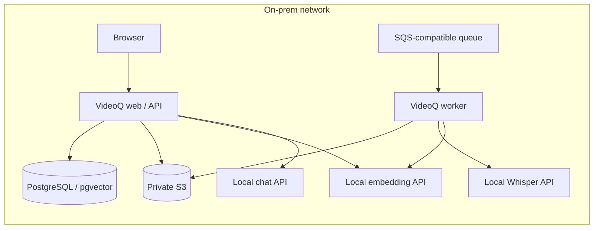

# Local inference for VideoQ

This optional chart installs selectable private LLM / embedding servers and
whisper.cpp (CPU) / vLLM (NVIDIA) speech services. llama.cpp is the CPU default; vLLM is the NVIDIA GPU
option. Install it separately from the application chart so
model caches, GPU scheduling and application upgrades have separate lifecycles.
For new local installations, use the explicit **gpt-oss-20b + EmbeddingGemma 2 +
Whisper** profile below. The chart's unoverlaid Qwen defaults are retained for
compatibility with existing CPU deployments.
The application chart's default still uses hosted OpenRouter; explicitly apply its
`examples/local-ai-llamacpp.yaml` or `examples/local-ai-vllm.yaml` overlay to select these services.

Mac development runs whisper.cpp natively with Metal, outside this Linux
Kubernetes chart. Both speech engines use the application's `local` backend;
see the [Mac setup and common API contract](../../docs/guides/local-inference.md#mac-development-with-whispercpp).

## One RTX 4090

For GPT-OSS 20B, text-only EmbeddingGemma 2 (768 dimensions) and Whisper
large-v3-turbo on the same GPU, use `examples/rtx4090-gpt-oss-embeddinggemma.yaml`.
The [native one-command installer](../../scripts/onprem/RTX4090.md) also installs
K3s, backing services, VideoQ and the initial administrator. This configuration
passed simultaneous residency and real inference smoke checks on Ubuntu 22.04.5
with about 20 GiB VRAM in use. The CUDA embedding image is built locally and
pinned by digest, rather than being covered by the signed release attestation.
See [profile details](examples/rtx4090-gpt-oss-embeddinggemma.md) for limits and evidence.

### Alternative Qwen candidate

Use `examples/rtx4090.yaml` for three independent CUDA inference Deployments on
one physical RTX 4090 with NVIDIA Device Plugin time-slicing. Each requests one
`nvidia.com/gpu.shared` slot. This replaces the three-exclusive-GPU requirements
of `examples/vllm-nvidia.yaml`; it does not merge services or move inference to
CPU. Follow the [workstation setup and hardware acceptance checklist](../../docs/guides/rtx4090.md).
The Qwen variant has not received hardware/model acceptance. The device-plugin values
file is for NVIDIA's chart, not this inference chart.

## Placement and capabilities



CPU defaults use Qwen3-4B Q4_K_M chat, gte-Qwen2-1.5B Q4_K_M embeddings
(native 1536 dimensions) and
whisper.cpp with multilingual quantized `ggml-large-v3-turbo-q5_0.bin`. These are starting points for a small acceptance
test. Measure production model quality, throughput, RAM and GPU VRAM with the
site's Japanese videos. The CPU overlay disables visual inspection because its
chat model accepts text only. Transcription, subtitle search, cited Q&A and
timestamp playback remain available. To enable visual inspection, provision a
local vision model supporting images, tool calls and strict JSON Schema,
validate it, and change both charts' chat model plus `config.videoVisualEnabled`.

The site provides PostgreSQL/pgvector, S3 and a persistent SQS-compatible queue
as described in the application chart. No Cloudflare, OpenRouter or OpenAI account
is required for this local configuration. Initial image/model downloads use the
internet. During processing, video, audio, prompts and embeddings stay on the
configured site services.

## Choose an inference engine

| Recipe | Inference values | Application values | Model placement |
|---|---|---|---|
| Recommended | `examples/gpt-oss-embeddinggemma.yaml` | `charts/videoq/examples/local-ai-gpt-oss.yaml` | One GPU for gpt-oss; CPU EmbeddingGemma 2 and Whisper |
| llama.cpp CPU | defaults or `examples/llamacpp-cpu.yaml` | `charts/videoq/examples/local-ai-llamacpp.yaml` | Separate CPU chat and embedding Pods; Whisper CPU |
| vLLM NVIDIA | `examples/vllm-nvidia.yaml` | `charts/videoq/examples/local-ai-vllm.yaml` | Three GPUs, one each for chat, embedding and Whisper |

The application connects to OpenAI-compatible Chat Completions and embeddings.
Private llama.cpp and vLLM servers use the same protocol as hosted OpenAI.
`EMBEDDING_BASE_URL` selects the embedding endpoint. `ai.embeddingBaseUrl` / `EMBEDDING_BASE_URL` is independent of
`ai.openaiBaseUrl` / `OPENAI_BASE_URL`. An empty embedding URL uses the configured
chat base URL. Optional `EMBEDDING_API_KEY` in the runtime Secret
selects a separate embedding credential; otherwise `OPENAI_API_KEY` is reused.
For the private unauthenticated recipes, use `local-inference` placeholders.
Authentication for existing protected inference services is configured by the
site; these recipe services rely on private ClusterIP and NetworkPolicy.

The same app configuration can point to separately operated compatible servers,
including different chat and embedding runtimes. This chart's `backend` selects
the fallback runtime; `servers.chat.engine` and `servers.embedding.engine` may
select independent engines. Model templates, tool parsers and JSON Schema
behavior must pass the common acceptance suite; API compatibility alone does not
establish VideoQ compatibility. The tested Qwen3/llama.cpp recipe requires
`separateToolSchema=true`. The vLLM recipe starts with
native tools plus schema enforcement and requires GPU acceptance.

The llama.cpp recipe uses pinned Qwen3-4B Q4_K_M chat weights and a pinned
`second-state/gte-Qwen2-1.5B-instruct-GGUF` Q4_K_M embedding conversion. Review the
conversion publisher and SHA256 before site acceptance. That embedding model
natively returns 1536 dimensions. The pinned llama.cpp server does not reduce
Qwen3-Embedding-4B's 2560 dimensions through the request's `dimensions` field;
VideoQ rejects that mismatch, without truncation or padding. vLLM uses Qwen3-4B
and Qwen3-Embedding-4B safetensors, explicitly permitting the latter's trained
Matryoshka output at 1536 dimensions. See [llama.cpp server](https://github.com/ggml-org/llama.cpp/blob/master/tools/server/README.md)
and [vLLM embedding configuration](https://docs.vllm.ai/en/latest/models/pooling_models/embed/#matryoshka-embeddings).

**Rebuild all scene embeddings before searching when changing embedding weights,
quantization, pooling or preprocessing**, even if both configurations return
1536 dimensions. Each profile uses a distinct embedding model alias. API and
worker must receive the same alias and endpoint. When replacing weights, change
both `servers.embedding.servedModel` and `ai.embeddingModel` rather than reusing
an old alias. The existing database does not automatically migrate vector spaces.

## Recommended gpt-oss + EmbeddingGemma 2 + Whisper profile

This profile pins `openai/gpt-oss-20b` and `google/embeddinggemma-2` to immutable
Hugging Face revisions. Chat uses vLLM's OpenAI tool and reasoning parsers with
low reasoning effort. Embeddings use `embedding_server.py` in a separate CPU
Pod, loading only the 270M text encoder. Whisper remains the existing
large-v3-turbo Q5_0 whisper.cpp service. The GPU must support the pinned vLLM
runtime and gpt-oss quantization; measure VRAM with the configured 8192-token
context and concurrency on the target GPU. CPU-only inference for gpt-oss is
not provided by this profile.

Use `separateToolSchema: true` in the application profile: make tool decisions
without the final-answer grammar, then enforce the strict JSON schema on the
terminal answer. The real-model compatibility check requires this separation
with the pinned vLLM runtime. Preserve gpt-oss reasoning internally across tool
continuations with `preserveToolReasoning: true`.

The CPU image must include this version's `embedding_server.py` and locked
sentence-transformers dependencies. Build from this source and record the
resulting digest; do not reuse an older Whisper-only image:

```sh
docker build -t registry.example.edu/videoq/inference-cpu:YOUR_TAG apps/inference/whisper
docker push registry.example.edu/videoq/inference-cpu:YOUR_TAG
```

Set `whisper.image.repository`, `whisper.image.tag` and `whisper.image.digest`
in an operator-owned `/secure/inference-site.yaml` to that reviewed build. The
shared CPU image supplies the speech gateway, embedding server and setup-only
model downloader in separate containers. It does not share a loaded model
between Pods. Use a signed release built from the same source when available;
retain its scan, SBOM and provenance checks.

```sh
helm upgrade --install inference charts/videoq-inference -n videoq --create-namespace \
  -f charts/videoq-inference/examples/gpt-oss-embeddinggemma.yaml \
  -f /secure/inference-site.yaml --wait --timeout 30m
helm upgrade --install videoq charts/videoq -n videoq -f /secure/site.yaml \
  -f charts/videoq/examples/local-ai-gpt-oss.yaml --wait --timeout 15m
```

The application migration adds `scene_embeddings_768`. API queries and worker
documents use separate model prompts and the same 768-dimensional space; the
existing 1536-dimensional table is retained. Both app processes must use
`EMBEDDING_PROFILE=embeddinggemma2`, the same pinned model alias and the dedicated
embedding endpoint. Leave `PGVECTOR_COLLECTION_NAME` unset so the profile selects
the correct table. Reindex existing transcripts in a maintenance window before
opening search, using the [cutover instructions](../../docs/guides/local-inference.md).
Changing back to an old model requires rebuilding any subsequently changed videos.

API and worker put the pinned `SearchQuery`/`Document` prefixes into the
standard OpenAI `input` field. The private CPU `/v1/embeddings` service preserves
that input without adding a second prompt, normalizes vectors, and
rejects unknown models, non-768 output requests and overlong inputs. It uses
local weights, disables image/audio encoders and never enables remote code.
Multimodal indexing is not enabled by selecting this profile.

For a real-model protocol check, set private endpoint URLs and run the opt-in
suite (it uses public, nonsensitive text and never calls hosted defaults):

```sh
LOCAL_AI_TEST_CHAT_BASE_URL=http://127.0.0.1:8000/v1 \
LOCAL_AI_TEST_MODEL=videoq-chat LOCAL_AI_TEST_REASONING_EFFORT=low \
LOCAL_AI_TEST_SEPARATE_TOOL_SCHEMA=true LOCAL_AI_TEST_PRESERVE_TOOL_REASONING=true \
LOCAL_AI_TEST_EMBEDDING_BASE_URL=http://127.0.0.1:8001/v1 \
LOCAL_AI_TEST_EMBEDDING_MODEL=embeddinggemma-2-f9972ac \
LOCAL_AI_TEST_EMBEDDING_PROFILE=embeddinggemma2 \
LOCAL_AI_TEST_WORKER_PYTHON="$PWD/apps/worker/.venv/bin/python" \
npm run test:unit --workspace @videoq/api -- test/local-inference.integration.test.ts
```

Protected endpoints also need `LOCAL_AI_TEST_API_KEY` and, if different,
`LOCAL_AI_TEST_EMBEDDING_API_KEY`. Pass them privately through the environment.
The suite checks tool calls, final JSON, SSE, CPU/Python indexing compatibility
and Japanese-to-English/English-to-Japanese retrieval. End-to-end acceptance on
a disposable site additionally uses `.github/onprem-lab/model-e2e.mjs`: prepare
`ja.mp4` and `en.mp4` from the attributed public speech fixtures and provision
`models_lab` / `model-validation@example.invalid` into `activation.json`. It
checks real upload, transcription, indexing and cited Q&A in all four language
combinations. This is a small acceptance sample, not a production quality or
capacity benchmark. The runtime's image/driver compatibility and private egress
policy still need validation on the deployment hardware.

## Install llama.cpp or vLLM

Download and verify a [signed public release](../../docs/guides/on-premises-releases.md)
first. It includes both chart archives and generates `verified-images.json` for
the app and `verified-inference.json` for inference. The CPU gateway supports
amd64/arm64; the patched NVIDIA vLLM engine supports amd64. No site image build
or GHCR pull authentication is required. Chat and embedding init containers
reuse the gateway image's locked Hugging Face downloader.
GGUF downloads use exact revisions and SHA256; safetensors snapshots use exact
revisions and exclude pickle weights and Python code. Serving Pods mount weights
read-only and run offline. Cached complete models skip network downloads.

Choose one inference/application pair from the table, for example:

```sh
helm upgrade --install inference /secure/videoq-release/videoq-inference-0.1.0-sha.$SOURCE_SHA.tgz \
  --namespace videoq --create-namespace \
  -f charts/videoq-inference/examples/llamacpp-cpu.yaml \
  -f /secure/inference-site.yaml -f /secure/videoq-release/verified-inference.json \
  --wait --timeout 30m
helm upgrade --install videoq /secure/videoq-release/videoq-0.1.0-sha.$SOURCE_SHA.tgz \
  --namespace videoq -f /secure/site.yaml \
  -f charts/videoq/examples/local-ai-llamacpp.yaml \
  -f /secure/videoq-release/verified-images.json --wait --timeout 15m
```

For vLLM replace both profile filenames with `vllm-nvidia.yaml` and
`local-ai-vllm.yaml`. Install the NVIDIA device plugin and review GPU VRAM first.
The profile reserves **three allocatable GPUs** without sharing: chat, embedding and Whisper. Resource limits are starting values, not measured production sizing.
vLLM GPU inference and driver compatibility require actual site acceptance;
the CPU llama.cpp test does not validate them. The signed NVIDIA image is used
for chat, embeddings and speech. Review its retained scan report and scoped
kernel-header assessment before promotion. Direct use of another upstream
vLLM image needs a separate scan and compatibility acceptance.

These profiles serve `videoq-inference-chat:8000`,
`videoq-inference-embedding:8000` and `videoq-inference-whisper:8080`.
Use `downloadModels=false` and `networkPolicy.denyEgress=true` after provisioning,
retaining the selected engine profile on every Helm upgrade. Changing `backend`
replaces Deployments; it does not convert PVC contents. Back up old caches and
adopt existing compatible claims explicitly. PVCs use a keep policy.

## Site settings and optional private rebuilds

Keep an operator-owned `/secure/inference-site.yaml` outside the repository:

```yaml
networkPolicy:
  clientNamespace: videoq
  clientRelease: videoq
```

The release verifier supplies `whisper.image`, `whisper.vllmImage` and
`vllm.image` as immutable public image references and requires image digests.
The signed chart pins the upstream llama.cpp image. Never replace reviewed
image values with a tag. If a site needs a private rebuild, build
`apps/inference/whisper/Dockerfile` (amd64/arm64) or `Dockerfile.vllm` (amd64),
retain the same license, scan/SBOM and provenance controls, and use an explicitly
reviewed site-owned image values file instead of the public image values.

External-image findings are evaluated against the actual deployment before
blocking promotion. See the [upstream inference runtime assessments and maintenance
policy](../../apps/inference/llamacpp/security/README.md). The scoped APT assessment
does not patch the upstream image or apply to operator overrides, host package
management or upstream image builds. CI retains raw findings, verifies the chart's
non-root/read-only runtime, rejects unassessed findings and requires review before
the assessment expires. Daily Operations scans continue independently of PRs.

Use that file with the selected inference/application pair above. The overlay
assumes namespace `videoq`; update the service URLs if changing namespace,
service names or cluster DNS suffix. Match `networkPolicy.clientRelease` to the
application Helm release. Set `OPENAI_API_KEY=local-inference` in its Secret
(and optionally `EMBEDDING_API_KEY`); keep the other runtime credentials from the
application guide. Secret environment variables can override ConfigMap endpoints.

## Restrict processing to the site

Whisper always loads local files, sets `HF_HUB_OFFLINE=1`, and mounts runtime
weights read-only. Its API accepts only `whisper-local` and exposes no model
management. Failures stay local; there is no automatic hosted fallback.

The llama.cpp app overlay sets `ai.reasoningEffort: none` and
`ai.separateToolSchema: true`. The latter separates tool decisions from the
final-answer grammar. When
no more tools are requested, the adapter makes a native JSON Schema call from
the original messages and retrieved evidence. An intermediate draft is discarded
and never streamed or used as conversion input. This adds one final model call;
hosted defaults keep their existing flow. Acceptance includes the production
streaming RAG agent with real inference and fixed retrieval evidence.

CPU inference can take several minutes per agent answer. The local overlay sets
both request deadlines to 600000 ms (ten minutes); set the site's ingress and
client timeouts accordingly. The default hosted deadlines remain unchanged.
GPU deployments can reduce these values after measuring their latency.

The application overlay creates an egress NetworkPolicy allowing its own
namespace and cluster DNS. Add infrastructure namespaces or exact intranet CIDRs
when DB, S3, queues or inference run elsewhere:

```yaml
networkPolicy:
  localEgressOnly: true
  allowedNamespaces: [videoq-data]
  allowedCIDRs: [10.40.20.0/24]
```

The CNI must enforce NetworkPolicy. Policies are additive: remove any other
policy that permits broader egress. Verify from an application Pod that site
services work and public HTTPS is blocked. Add the node-local DNS IP explicitly
if the cluster uses NodeLocal DNS. See
[Kubernetes NetworkPolicy](https://kubernetes.io/docs/concepts/services-networking/network-policies/).
After provisioning, remove downloaders and deny inference egress:

```sh
helm upgrade inference charts/videoq-inference --namespace videoq \
  -f /secure/inference-site.yaml --set downloadModels=false \
  --set networkPolicy.denyEgress=true --wait --timeout 15m
```

Persist these settings in the operator values for future upgrades. Missing
weights fail startup or keep inference Pods unready. Nodes can still pull container images before Pod
startup. The on-prem application edition disables external mail, Google OAuth, Stripe
and YouTube/SearchAPI. This recipe handles uploaded videos and administrator-issued
local accounts; it does not change an explicitly selected inference endpoint.

## NVIDIA Whisper engine

The complete `vllm-nvidia.yaml` profile selects vLLM for speech as well as chat
and embeddings. To add only a speech GPU to a CPU chat/embedding installation,
apply `examples/whisper-nvidia.yaml` and set the application's
`ai.whisperChunkSeconds: 300`. Each model has its own process and dedicated GPU.

Build the audio-capable NVIDIA engine from its separate Dockerfile, scan the
result, push it privately and record its digest alongside the gateway digest:

```sh
docker build --platform linux/amd64 -f apps/inference/whisper/Dockerfile.vllm \
  -t registry.intranet/videoq-vllm-engine:0.2.0 apps/inference/whisper
trivy image --scanners vuln --severity HIGH,CRITICAL --ignore-unfixed=false --exit-code 1 \
  registry.intranet/videoq-vllm-engine:0.2.0
docker push registry.intranet/videoq-vllm-engine:0.2.0
```

```yaml
whisper:
  vllmImage:
    repository: registry.intranet/videoq-vllm-engine
    digest: sha256:REPLACE_WITH_REVIEWED_DIGEST
```

The pinned vLLM 0.32.0 base needs its `vllm[audio]` extras. The profile provisions
`openai/whisper-large-v3-turbo` at an immutable revision before serving; runtime
uses that local directory. Initial L4 validation used 70% GPU-memory reservation
and eight active sequences. This is not a measured minimum VRAM requirement.
Validate the site's driver, GPU capacity and recognition quality before rollout.

## Speech preprocessing and batching

Both profiles expose the same private gateway on port 8080 and the app uses
`WHISPER_BACKEND=local`, `whisper-local`, `verbose_json`, and segment timestamps.
The engine listens only on loopback port 8081, including its model-management
routes. Only the gateway has a Service. It normalizes audio levels, uses bundled
Silero ONNX VAD, merges only overlapping VAD padding, keeps spans within 30 seconds, and restores original
source offsets after recognition. Silent input returns no captions. Text without
real timestamps is rejected rather than converted into a fabricated subtitle.
Requests cannot change weights, command arguments, or inference URLs.

`whisper.upstreamParallelism` is 1 for CPU and 4 for NVIDIA.
`whisper.maxConcurrentRequests` bounds uploads and active video requests (CPU 1,
NVIDIA 2); excess traffic receives retryable 503 responses. NVIDIA's
`whisper.maxSequences: 8` configures vLLM's dynamic batching across those speech
requests. It does not wait for eight videos to arrive. The previous faster-whisper
batch-size/device/compute-type fields are removed and rejected by the schema.

The CPU application profile uses 30-second durable checkpoints; NVIDIA and cloud
use 300 seconds. `ai.whisperChunkSeconds` / `WHISPER_CHUNK_SECONDS` accepts 30–300
seconds. Short CPU checkpoints keep individual calls within the gateway's 600-second
budget and the worker's 660-second deadline without extending queue leases. Completed results
are reused after retries and their offsets remain relative to the source video.
Existing plans keep their recorded interval size. Drain incomplete plans on
the previous release before changing runtimes or CPU/GPU profiles; a retry
does not resize an existing plan. No retired-provider fallback is retained.
The serial on-prem poller defaults to one message at a time. Measure service
capacity before increasing worker replicas or admission limits.

CPU's quantized multilingual large-v3-turbo model is a small acceptance baseline, not a promise of
Japanese recognition accuracy. Larger checkpoints need more CPU/RAM and may need
shorter worker intervals. Review weights, checksums, source coverage, silence,
Japanese accuracy and throughput with representative site recordings.

## Configuration contract

Install using the selected engine profile and a current operator values file.
Only the documented fields are accepted; unknown chart options fail validation.
Chat and embedding endpoints/models must match the application profile. There
is no provider selector: the embeddings protocol is OpenAI-compatible.

## Acceptance checks

From a reviewed checkout with npm dependencies, uv and FFmpeg installed,
port-forward the private services in separate terminals:

```sh
kubectl -n videoq port-forward service/videoq-inference-chat 11436:8000
kubectl -n videoq port-forward service/videoq-inference-embedding 11437:8000
kubectl -n videoq port-forward service/videoq-inference-whisper 18085:8080
```

Never expose these ports publicly. Use a short, nonsensitive speech video.
 Set the
embedding alias for the chosen recipe (`qwen3-embedding-4b-5cf2132a` for vLLM).
For vLLM start with `LOCAL_AI_TEST_SEPARATE_TOOL_SCHEMA=false`, matching its app profile:

```sh
LOCAL_AI_TEST_CHAT_BASE_URL=http://127.0.0.1:11436/v1 \
LOCAL_AI_TEST_EMBEDDING_BASE_URL=http://127.0.0.1:11437/v1 \
LOCAL_AI_TEST_MODEL=videoq-chat \
LOCAL_AI_TEST_SEPARATE_TOOL_SCHEMA=true \
LOCAL_AI_TEST_EMBEDDING_MODEL=gte-qwen2-1.5b-q4km-124fbdad \
LOCAL_AI_TEST_WORKER_PYTHON="$PWD/apps/worker/.venv/bin/python" \
  npm run test:unit --workspace @videoq/api -- test/local-inference.integration.test.ts
WHISPER_BACKEND=local WHISPER_LOCAL_URL=http://127.0.0.1:18085/v1 \
EMBEDDING_BASE_URL=http://127.0.0.1:11437/v1 \
EMBEDDING_MODEL=gte-qwen2-1.5b-q4km-124fbdad EMBEDDING_API_KEY=local-inference \
  uv run --project apps/worker --locked python \
  apps/worker/scripts/check_local_inference.py /secure/test.mp4 --seconds 30
```

The same suite checks native structured answers, tools, streaming, cited RAG and
1536-dimensional embeddings. With `LOCAL_AI_TEST_WORKER_PYTHON` it also compares
TypeScript query embeddings to a real Python indexing batch. The RAG test uses
fixed retrieval evidence, not a live database or browser. Optional protected
services use `LOCAL_AI_TEST_API_KEY` / `LOCAL_AI_TEST_EMBEDDING_API_KEY`.
`LOCAL_AI_TEST_SEPARATE_TOOL_SCHEMA=true` is available when a particular
model/server needs the two-call workaround; record that choice in app values.
Finish with upload → transcription → indexing → cited Q&A → timestamp playback
through the UI with public egress blocked. Record model/image digests and site
quality/throughput results. The worker check does not write to the DB.
Uninstall inference separately from the app; PVCs are retained. Adopt compatible
claims through `persistence.existingClaim` on reinstall.

The NVIDIA speech image includes a narrowly scoped kernel-header [OpenVEX assessment](../../apps/inference/whisper/security/README.md). Preserve the JSON scan report, including suppressed findings, with the reviewed image digest. Its passing assessed gate does not establish the site host kernel's patch status.


## Upstream CPU speech engine

CPU whisper.cpp now runs directly from an immutable upstream image in a separate
container; VideoQ no longer compiles the engine into its audio gateway. The
gateway keeps preprocessing and the public speech API, connecting to the engine
over Pod loopback. The existing NVIDIA engine and vulnerability gates are retained.
Use `examples/cpu-arm64.yaml` in the inference chart for ARM64. Cached weights
support offline restarts. CI scans each upstream CPU engine on amd64 and arm64.
The explicit whisper.cpp header-only assessment requires matching the complete
flattened filesystem inventory first, and assessed findings remain in reports.
It does not certify the host kernel. See `apps/inference/whispercpp/security/`.

AMD/ROCm configuration is a separate follow-up; no target GPU/OS has been selected
and hardware execution remains unverified. GPU adoption requires physical
acceptance and vulnerability evaluation.
