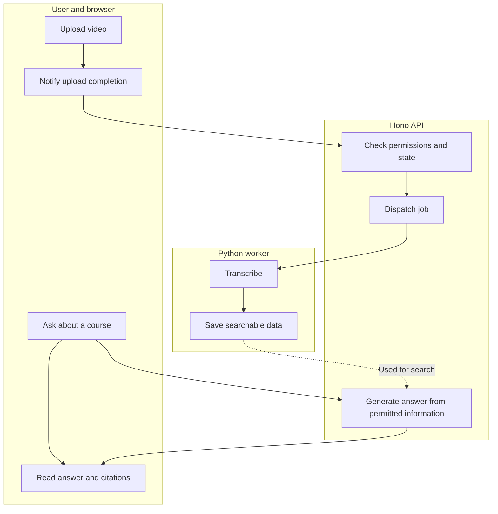
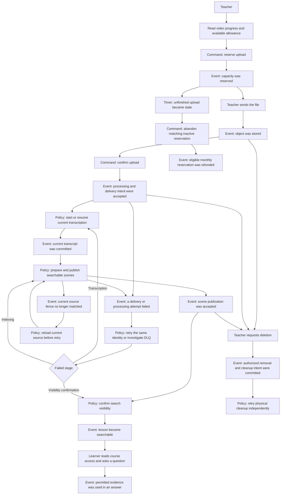

# Processing flow by responsibility

This flow shows where responsibility passes between components. It uses Mermaid for readability rather than strict BPMN notation.

## From video to answer

The API answers questions. The worker does not send answers directly to the browser after processing.

## Business process: material accepted to searchable lesson

This model describes the existing implementation as of 2026-11-24. Events are
names for business facts, not a claim that an event store exists. Context and
aggregate names below are design hypotheses derived from code. No product-owner
workshop or stakeholder agreement is claimed.

Scope starts when a teacher reserves an upload and ends when an authorized
learner can retrieve its lesson evidence. YouTube registration enters at job
acceptance and does not reserve an uploaded object in the same way.

The failure/retry arrows show causality; each stage resumes its own operation.
An indexing retry does not automatically restart transcription. Deletion is
available only through its authorization and state preconditions; diagram arrows
do not add a new cancel button or bypass those checks.

### Commands, decisions and responsibility

| Responsibility candidate | Command and facts it needs | Invariant and synchronous boundary | Later work |
|---|---|---|---|
| Upload reservation / material ingestion | Reserve or confirm; owner, current allowance, object identity and upload state | Reserve once; confirm the matching upload; commit state and delivery intent together | Object transfer and queue dispatch can fail independently and need recovery |
| Transcription run / material ingestion | Start, resume or finish; file, run ID, source revision, saved chunks | Accept only a current run; reserve processing usage once; preserve a newer manual transcript | Follow-up indexing and optional visual cache |
| Scene publication / evidence retrieval | Start, stage, publish and finish; owner, source revision, run and physical vector identity | Reject stale source/run; search completion requires the configured readiness checks | Provider indexing acceptance and search visibility can occur at different times |
| Course access / learning | Ask; current membership/share/LMS authority, selected course videos | Validate current scope; recheck ownership/revision/physical identity when hydrating evidence | Generate an answer from permitted evidence |
| Removal / material ownership | Delete; owner, expected file/state and inactivity boundary when applicable | Remove authorized DB visibility and persist cleanup intent atomically | Physical object/vector cleanup retries; it need not finish with the user request |

These are logical responsibility boundaries. They do not prescribe new services
or one class/table per aggregate. See [job recovery](flowchart.md) for the actual
runtime handoffs and [indexing outcomes](../design/state-diagram.md#search-indexing-outcomes)
for application results.

Terms used here: **accepted** means durable intent exists; **completed** refers
to the particular operation's completion checks. A **reservation** holds an
allowance before final use. A **source revision** identifies the material version;
a **run** is an attempt to process that version. **Retry** reuses an operation's
identity, while an intentional **reprocess** may create new work.

### Read models and people

Teachers decide whether to wait, correct a transcript, reprocess or remove a
material using video state/error details, course membership and usage summaries.
Learners decide which lesson to inspect using their permitted course and the
answer's citations. Operators use delivery state, structured failure codes and
DLQ contents to decide whether configuration/data needs correction before replay.
These decisions are distinct from automatic policies triggered by a committed
fact or expiry timer.

### Hot Spots and confirmation owners

Initial policies have since been decided under delegated authority on 2026-11-25.
See the [decision register](https://github.com/videoq-jp/videoq/blob/main/docs/operations/business-decisions-2026-11-25.md) for the
responsible account, review deadline, acceptance examples and remaining monitoring
integration. The table below preserves the original implementation questions.

| Question | Current implementation evidence | Confirmation still needed |
|---|---|---|
| Does “completed” mean searchable? | Scene-index workflow distinguishes publication from readiness; current-source finish checks must succeed. Queue ACK can mean only a durable handoff. | Product owner + operations: user-facing readiness target and tolerable propagation delay |
| When is usage returned? | Only an unconfirmed upload in the exact reservation period can refund monthly upload usage; storage is released by durable physical cleanup. Confirmed upload usage is retained. | Product owner: whether this existing rule remains the desired customer policy |
| What wins between worker completion and a manual edit? | Transcription and indexing use source/run/revision fences; stale work cannot overwrite an accepted newer source. | Product owner: desired learner experience while a new version is being prepared |
| What wins between removal and late completion? | Removal checks ownership and expected state/file; downstream writes and search hydration retain source/visibility checks. A late storage PUT may still require cleanup. | Operations + material owner: acceptable cleanup lag and escalation responsibility |
| Is retry equivalent to running a new operation? | Same job ID shares the execution barrier; expired/busy/completed leases have different meanings. External operations still need stage-level retry safety. | Operations: replay approval and investigation steps for permanent input/identity conflicts |

Implementation evidence is in
[video mutation policy](https://github.com/videoq-jp/videoq/blob/main/apps/api/src/application/video-mutation.ts),
[transcription policy](https://github.com/videoq-jp/videoq/blob/main/apps/api/src/application/transcription-policy.ts),
[scene indexing](https://github.com/videoq-jp/videoq/blob/main/apps/api/src/application/scene-index-execution.ts),
[search hydration](https://github.com/videoq-jp/videoq/blob/main/apps/api/src/application/scene-retrieval.ts)
and their repository contract tests. Unconfirmed Hot Spots are not new agreed
requirements; a policy change needs an explicit decision and corresponding tests.

## Where to investigate problems

| Problem | Check first | Next reference |
|---|---|---|
| Cannot upload a file | Browser, storage, API | [Troubleshooting](../guides/troubleshooting.md) |
| Video is not processed | Job delivery, queue, worker | [Job delivery and recovery](flowchart.md) |
| Answers are unrelated to the content | Search scope, subtitles, prompts | [Prompt design](prompt-engineering.md) |

**Related:** Follow calls over time in the [sequence diagrams](../design/sequence-diagram.md), or start from user actions in the [activity flow](../requirements/activity-diagram.md).
