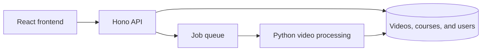
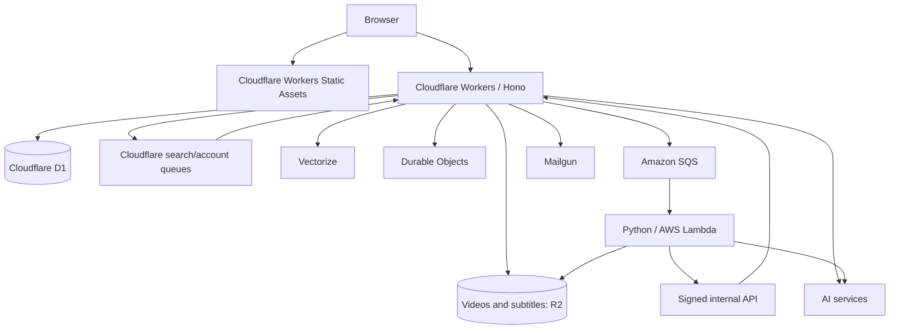

# System overview

VideoQ separates the API that responds to user actions from time-consuming video processing. Start with the three application components in this diagram to understand each technology's role.

The frontend fetches state from the API. Once the worker saves transcripts and indexes, the frontend can use those results.

## Responsibilities of the three apps

| App | Responsibility | Main code |
|---|---|---|
| Web | Display, forms, question input, and playback | `apps/web/src/` |
| API | Authentication, access control, business logic, and job requests | `apps/api/src/` |
| Python worker | Transcription and indexing | `apps/worker/worker_python/` |

See the [logical ownership and release contract](https://github.com/videoq-jp/videoq/blob/main/docs/architecture/responsibility-and-release-contract.md) for shared-state invariants and staged consumer changes.

Web and API share operation names and input/output types through `packages/trpc`. SQS JSON messages and the database form the boundary with Python.

## Local and production equivalents

| Role | Local | Production |
|---|---|---|
| Frontend | Static nginx build or Vite | Cloudflare Workers Static Assets |
| API | Wrangler development server | Cloudflare Workers |
| Database | PostgreSQL + pgvector | Cloudflare D1 |
| API-to-DB connection | Local connection string | D1 binding; media worker uses the signed internal API |
| Video, subtitle, and other storage | Garage | Cloudflare R2 |
| Job queue | ElasticMQ (media/search/account) | SQS media; Cloudflare Queues search/account |
| Python worker | Container continuously polling the queue | AWS Lambda triggered by SQS |
| Temporary API state | Local Durable Objects | Cloudflare Durable Objects |

Locally, Caddy routes `http://localhost` to the frontend and API. Development Vite uses port 3000, and the documentation site uses 3001.

## Production layout

The cloud API uses D1; the media worker reaches shared mutations through the signed internal API. On-premises API and Python/Node workers share PostgreSQL. Check both persistence backends and message contracts when changing shared state.

Cloud AI inference uses Workers AI bindings. The media Lambda requests transcription through the signed internal API; the Worker executes inference. On-premises deployments can use OpenAI-compatible servers.

## Durable Object roles

- `RATE_LIMITER`: Limits excessive requests over short periods.
- `TASK_SCHEDULER`: Schedules recovery of undelivered jobs and abandoned uploads.
- `CHAT_EXECUTION`: Runs each chat answer in its own SQLite-backed object, so long tool loops do not depend on the ordinary Worker CPU limit. See [answer streaming troubleshooting](../guides/troubleshooting.md#answer-streaming-fails-or-citations-arrive-later).

Recovery is scheduled with Durable Object alarms. The current cron schedule is daily at `17 3 * * *` (UTC), for cleanup and recovery. Do not assume a five-minute cron schedule.

The implementation entry point is [app.ts](https://github.com/videoq-jp/videoq/blob/main/apps/api/src/app.ts), and runtime configuration is in [wrangler.jsonc](https://github.com/videoq-jp/videoq/blob/main/apps/api/wrangler.jsonc).

**Read next:** [Find your way around the code](../getting-started/codebase.md), [Job delivery and recovery](flowchart.md).
