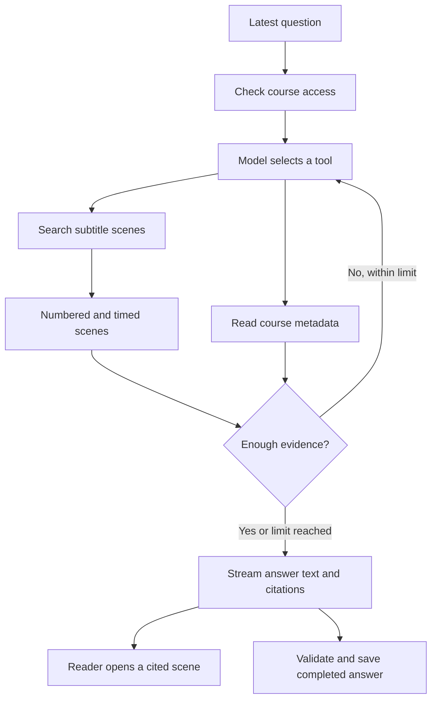

# How AI builds an answer

VideoQ prepares text from videos, retrieves material relevant to a question, and asks a language model to write an answer using that material. This is **RAG** (retrieval-augmented generation; [Lewis et al., 2020](../reference/ai-references.md#rag)). The steps below describe the current implementation; they are not a claim that every answer is correct. [AI methods and references](../reference/ai-references.md) connects each method to its original paper or official model documentation and explains VideoQ's adaptations.

To see answers and citations in the student interface, [try the sample course without signing up](https://videoq.jp/en/try). For the instructor workflow, see [how to answer online course questions from your lectures](https://videoq.jp/en/guides/online-course-questions).

## Current behavior at a glance

Checked against the implementation on **2026-10-31**.

| Stage | Current behavior |
|---|---|
| Prepare videos | Acquire timestamped text, split it into scenes, then store 1536-dimensional embeddings |
| Find evidence | A LangChain agent chooses course metadata or scene search within the authorized course |
| Generate an answer | The model produces text segments with source IDs; the API owns the video titles and timestamps |
| Display the answer | Stream text and validated citations during generation; batch UI updates on the next animation frame |
| Save | Persist the completed structured answer and retrieved context |

The former Study mode and PLOG learning graph have been removed. Current Q&A supports follow-up questions; it does not create learning sessions, generate exercises, or track mastery. Historical removal instructions remain in the [deployment reference](../design/deployment-diagram.md).

## What does the AI actually read?

For an uploaded file, the worker extracts **audio** and transcribes it with Whisper. For a YouTube import, it retrieves existing subtitles through SearchAPI. Both paths produce text with timestamps.

By default, answers use subtitles. `overview_video` surveys a video's timeline, `skim_video` narrows a candidate interval, and `read_video_window` reads surrounding subtitle context. Image tools are enabled by default for uploads: overview and skim can check cached stills, `inspect_clip` reads coarse stills at higher image detail, and `focus_clip` checks short clips using approximately one-second frame intervals. Set `VIDEO_VISUAL_ENABLED=false` to opt out. The ReAct agent selects only the tools needed for the question. YouTube imports and uploads without a cache remain subtitle-only. Sparse frames can miss brief actions or illegible text. See [configuration and limits](../guides/visual-evidence.md).

The system has several distinct AI jobs:

| Job | Input | Result |
|---|---|---|
| Transcription for uploads | Extracted audio | Timestamped text |
| Embedding | Subtitle text or a search query | Numbers used to compare meaning |
| Q&A | Latest question, instructions, and tool results | Structured text segments and source IDs |
| Image inspection (uploads only) | Selected stills from the video | Text observations with timestamps |

An embedding does not write an answer. It helps find text for the language model to read. [See transcription and scene search](../architecture/transcription-and-search.md) for the preparation steps.

## Follow one question

Suppose a course contains a lesson explaining the dot product, and you ask:

> How does the dot product relate to the angle between two vectors?

The following is an **illustrative example**, not a captured production conversation. The search wording, returned scenes, number of searches, and answer can vary.



1. **Fix the accessible scope.** The API establishes the course and its allowed video IDs. The model cannot expand that scope by asking for another course's videos.
2. **Choose a tool and query.** For this content question, the model is instructed to use `search_scenes`. A possible query is “dot product angle cosine relationship.” It can rephrase the question to search for relevant material.
3. **Retrieve scenes.** The API embeds the query and searches the course's indexed subtitle text. Each search returns up to 20 scenes by default. It does not send the whole video to the answer model.
4. **Read the evidence.** A tool result might look like this:

   ```json
   {"sourceId":1,"title":"Dot product lesson","startTime":"00:02:10,000","endTime":"00:02:35,000","text":"The dot product is the product of the two vector lengths and the cosine of their angle."}
   ```

5. **Search again if needed.** The model may request another search, for example to find the explanation of perpendicular vectors. At most three scene searches are available per answer.
6. **Write and stream an answer.** With the example scene above, a possible answer is: the text “The dot product depends on the cosine of the angle as well as the lengths of the two vectors.” paired with `sourceIds: [1]`. Text appears during generation. Once the segment closes and its citation passes validation, the UI adds the timestamp link after that passage, without waiting for the whole answer.
7. **Check the source.** Selecting the citation opens the video's associated time. The timestamp comes from the stored subtitle scene; the answer wording comes from the model.
8. **Save the completed answer.** After validation, the API saves the question, structured answer and retrieved context, then emits `done`. No post-answer AI scoring runs.

The application assigns scene numbers, keeps them stable when a scene is found again, and provides citation data to the UI. The model pairs each passage with source IDs instead of embedding citation numbers in prose. A citation helps you verify an answer; it does not prove that every statement is supported.

## Why does text appear before the answer is complete?

Search progress, answer text, and citation links are separate stream events. The API decodes the model's structured output incrementally and sends only answer text and validated links. The browser groups received updates for its next animation frame; it does not add a character-by-character typing delay. A citation may appear slightly after its text while the API checks the completed segment and its position outside math or code.

Partial text is not a saved answer. An interrupted stream or invalid final response fails instead of saving an incomplete chat. See the [streaming contract](../architecture/prompt-engineering.md#streaming-contract) for completion, cancellation, and quota behavior.

## Why do some answers have no scene citation?

“How many videos are in this course?” can be answered using `get_course_info`, which reads registered course and video information. That tool does not need subtitle search. Metadata is not assigned scene citation numbers.

Without a selected course, the model has no retrieval tools or scene sources and is instructed to ask the user to select a course. This response is streamed but is not saved as a course chat.

For a question about a **specific lesson**, the model is instructed to identify it using course information, then restrict scene searches to the matching video IDs. A video's position in the list is not automatically its lecture number. A saved description can answer “What is the description?”, but it is not a substitute for searching the lesson when explaining its content.

## Does it remember the conversation?

The browser sends a conversation UUID and one new user question. After checking current course access, the server derives a thread ID scoped to the actor, owner, course, share route and conversation UUID. LangGraph keeps the conversation state in PostgreSQL through the official `PostgresSaver`. Saved course-wide chat logs are separate and are never loaded as a visitor's conversation.

LangChain's `summarizationMiddleware` compacts old context at approximately 6,000 tokens and uses the library default of retaining 20 recent messages verbatim, including tool messages. If there are no older messages outside that retained window, there is nothing to summarize even when the token trigger is met; the trigger is not a context-size cap. The trigger uses the library's approximate token counter, not an exact model token count. The trigger must be configured: omitting it disables summarization. The prompt, prefix, summary-input trimming and retained-message count use library defaults; no application output-token cap is set on the summary model. A separate model call creates the summary; it uses the configured chat endpoint/model and is included in the answer cost ledger as `conversation_summary`. The summary becomes part of the saved state, so later questions retain older context without resending the original history. A failed summary fails the answer rather than replacing good history with an error string.

The answering `createAgent` receives `PostgresSaver` directly. It retains native user/assistant messages, tool calls and tool results; there is no parent conversation graph or extraction of a separate conversation snapshot. Retained tool evidence can support follow-up answers; insufficient or outdated evidence requires another retrieval. A citation registry is stored in the agent state through the public middleware `stateSchema`, keeping source IDs stable across turns and compaction. Only sources in the currently authorized video set may be cited. Failed or cancelled generations do not append a visible conversational turn. Concurrent writes to the same thread are rejected using a bounded database lease.

The UI restores the selected conversation after reload and offers **My conversations**, **New chat**, and deletion with confirmation. Only conversation identifiers are saved in browser storage, partitioned by account, course and access route; original questions, structured answers, citations and feedback are loaded from a separate server-side transcript. Compaction does not rewrite that transcript. Earlier messages and the conversation list are paginated. Shared-link visitors can list only conversation UUIDs retained by their own browser, never all visitors' conversations. Course access is rechecked for every read, write and deletion. An expired/deleted conversation blocks continuation and offers a new chat instead of silently dropping context.

The visible transcript and course log are saved in one transaction, together with the successfully completed checkpoint ID. A new request supplies that committed `checkpoint_id` to LangGraph; failed or abandoned checkpoints remain in library history but are not used as conversation context. A first request with no committed checkpoint resets messages with the standard `RemoveMessage(REMOVE_ALL_MESSAGES)` operation and clears the citation registry, then adds the new question. Missing committed state is an error, never an automatic restart with forgotten context.

The agent owns its built-in message state and the official `PostgresSaver` owns checkpoint persistence. Durability is left unset, using LangGraph's default `async` behavior: checkpoints are written at each step while the next step runs. Intermediate state is retained, but the application resumes from its last committed answer rather than automatically continuing an unfinished answer. A process crash can lose the most recent asynchronous writes. This setting is **not a checkpoint-count limit**. The previous custom two-generation SQL cleanup has been removed: channel versions, parent pointers and checkpoint history are owned by the library. An actively used conversation can accumulate checkpoints until that conversation is deleted or expires; summarization bounds model context, not database history.

Personal conversations expire 30 days after the last question. Daily maintenance removes their transcript and checkpoints; opening an expired UUID also removes the expired state. Reading a conversation does not extend its expiry. Separate course question logs retain their existing lifetime. Explicit conversation deletion removes its corresponding course question logs as well as the personal transcript and checkpoints. Deleting a course, its complete chat history, or an associated account also removes the linked conversations. Deletion is rejected while an answer is running.

## What decides the next action?

| Decision | Who makes it? |
|---|---|
| Which course and videos may be accessed | API permission checks and search filters |
| Whether to request metadata or subtitle scenes, and what to search for | Model, guided by tool descriptions and prompts |
| How many search results and tool calls are allowed | Program constants and argument validation |
| How to phrase an answer and where to cite evidence | Model, following instructions |

Instructions ask the model to stay within the retrieved evidence and acknowledge missing information. This instruction is not the same as a program proving the answer correct. The search currently has no application-level minimum similarity cutoff, so even returned scenes can be irrelevant. A broad summary may cover only the retrieved excerpts, rather than every part of a long video.

## Where the data goes

Audio transcription, embeddings, image inspection, and answer generation call their configured model services, which are reached through OpenRouter in the hosted profile. These services receive the audio, images, or text needed for their respective step. Choosing local transcription or local embeddings alone does not make all AI processing local; Q&A has its own calls.

This describes the application's data flow. It does not establish a provider's retention or training policy. No production credentials or account identifiers are needed to understand or configure the flow.

## Explore the implementation

- [Transcription and scene search](../architecture/transcription-and-search.md): subtitles, scene boundaries, embeddings, and search limits.
- [Q&A prompts and answer persistence](../architecture/prompt-engineering.md): model inputs, tool decisions, failure behavior, and quality checks.

The Q&A implementation is [rag.ts](https://github.com/videoq-jp/videoq/blob/main/apps/api/src/lib/rag.ts). Its tools read [course information](https://github.com/videoq-jp/videoq/blob/main/apps/api/src/lib/rag-course-info.ts) and [scene search results](https://github.com/videoq-jp/videoq/blob/main/apps/api/src/repositories/vector-repository.ts). These are the source of truth when behavior changes.
