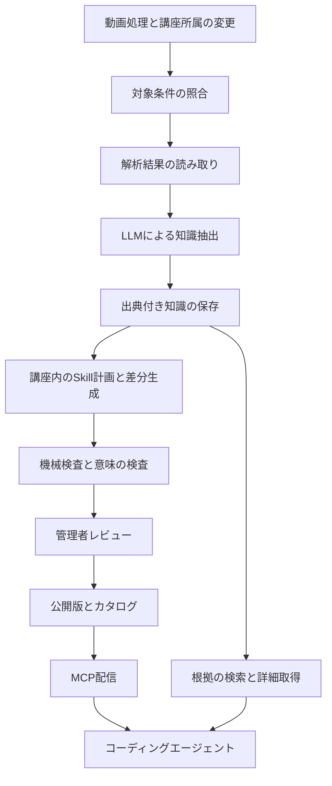

# VideoQ 講座知識のSkills生成とMCP配信設計

作成日: 2026年11月27日  
状態: 実装前の詳細設計  
対象読者: プロダクト設計者、API・ジョブ・UIの実装者、品質評価担当者

VideoQに登録された講座の知識を、コーディングエージェントが判断・実装・検証に利用できるSkillsとして配信する。動画の既存解析結果を再利用し、講座に所属する動画からタスク別のSkillsを育てる。動画を講座から除去した場合は、その動画だけを根拠にした知識を配信対象から取り除く。

本設計は既存コードとの対応付けを行わない。既存の文字起こし・画像抽出が利用可能であることを入力条件とする。会話で合意した要件を第1節に、実装のために具体化した提案を第2節以降に記す。データ名・API名・運用値は論理設計であり、既存実装の名称を表していない。

## 1 合意した要件

| ID | 要件 |
|---|---|
| R01 | 文字起こし・画像抽出の既存結果を再利用し、Skill生成のために同じ媒体処理をやり直さない |
| R02 | 動画の必要な処理が完了し、かつ講座に所属したとき、生成・更新処理の対象にする。二つの条件の成立順序は問わない |
| R03 | 一つの講座に、実装タスクごとの複数Skillsを保持する。個数を3〜5個などに固定しない |
| R04 | 一つのSkillは複数動画に依存でき、一つの動画も複数Skillsの出典になれる |
| R05 | 動画追加の結果は、新規Skill、既存Skillの更新、変更なし、知識のみ保留のいずれかになる |
| R06 | 講座間の知識を無条件に混ぜない。初期版では単一講座内でSkillsを生成する |
| R07 | 講座から動画を除去すると、その動画だけを根拠にした知識をSkillsから除去する。他の所属動画でも裏付けられる知識は残せる |
| R08 | 根拠を失って成立しないSkillは公開終了にする |
| R09 | 知識抽出・分類・文章化はLLM、権限・入力範囲・版・検証・公開制御はプログラムが担当する |
| R10 | Skills over MCPに対応したクライアントへ必要時に読み込める形で配信する |
| R11 | 公開前に内容と差分をレビューする。生成中の内容は配信しない |
| R12 | 取得済み・読み込み済みの知識の回収までは保証しない。サーバー側の以後の取得を制御する |

## 2 目的と対象範囲

利用者は、講座で説明された方針を自分のコードへ適用できる。エージェントはSkillの利用条件を見て選択し、既存コードを調査した上で、判断基準・実装手順・検証項目を使う。必要なら出典や具体例を追加取得する。

初期版は、講座単位の生成有効化、差分生成、レビュー、公開、動画除去への追随、認証付きMCP配信を対象とする。複数講座の統合、実装用コードの自動実行、全公開物の一括ファイル出力、無審査の自動公開は対象外とする。

生成有効化は講座管理者が行う。無効な講座では動画追加によるLLM処理は発生しない。有効化時には、既に所属している解析済み動画も同じ処理へ投入する。

## 3 基本概念

| 概念 | 意味 |
|---|---|
| 解析版 | 特定の動画に対する字幕・画像等の確定した解析結果 |
| 知識項目 | 原則、判断基準、手順、例外、検証、実例などの構造化された説明 |
| 出典 | 解析版、動画時刻、字幕区間または画像を特定する参照 |
| 講座スナップショット | 生成で使う所属動画と解析版の固定集合 |
| Skill | 一つの再利用可能なタスクを扱う論理的な単位 |
| Skill候補版 | LLM生成と検査を経てレビューする内容 |
| Skill公開版 | 内容、参照資料、manifestが固定された配信物 |
| 講座カタログ | その講座で現在公開されているSkill版の一覧 |

講座は知識の文脈と配信権限の境界、Skillは仕事の単位、動画は根拠となる。講座の章や動画本数をSkillの境界として固定しない。

## 4 構成と責務



| 構成要素 | 責務 |
|---|---|
| 対象条件の照合 | 講座所属、解析準備、生成設定を確認し、処理の重複を防ぐ |
| 解析結果アダプター | 既存の字幕・画像を共通入力へ変換する |
| 知識抽出 | 出典付きの構造化知識を生成する |
| Skill編集 | タスクの分類、新規・更新判断、Skill内容の作成を行う |
| 検査 | 形式・参照・入力範囲を機械検査し、意味の整合を補助評価する |
| 公開管理 | レビュー、版の固定、公開先切り替え、配信停止を行う |
| MCP配信 | 認証・認可済み利用者へメタ情報とファイルを返す |

LLMはDB更新、権限決定、公開可否の最終決定、MCP操作を直接行わない。

## 5 既存解析との接続契約

既存処理から、少なくとも動画ID、解析版ID、字幕区間と時刻、解析状態を取得する。画像がある場合は画像ID、対応時刻、利用可能状態を取得する。内部ストレージ参照はサーバー内で解決し、MCPへ直接露出させない。

画像抽出済みで内容が未解析の場合は、字幕で理解できないコード・図・操作の説明に必要な画像だけを追加で読み取る。追加処理は画像内容の解釈であり、フレーム抽出の再実行ではない。

解析版は不変とし、字幕修正・画像差し替えは新しい解析版になる。元の処理がこの性質を持たない場合、Skill側で入力の内容ハッシュを保存して版を識別する。

### 準備完了の条件

字幕だけで意味が成立する動画は字幕の確定で対象にできる。図やコードが不可欠と判断された箇所は、画像の準備・読み取りが完了するまでその知識の採用を保留する。画像処理の失敗だけで、字幕から独立して理解できる知識まで一律に破棄しない。

初期設定では、動画処理全体の完了通知で照合を開始する。字幕先行処理は後続の最適化とする。

## 6 開始条件とイベント

各動画について、次がすべて成立すると処理可能になる。

```text
講座のSkills生成が有効
AND 動画が現在その講座に所属している
AND 必要な解析結果が確定している
AND 同一入力に対する有効な結果がまだない
```

| イベント | 動作 |
|---|---|
| 解析完了 | その動画が所属する有効な講座を照合する |
| 講座へ動画追加 | 解析完了済みなら開始し、未完了なら待機する |
| 生成を有効化 | 現在の全所属動画を照合する |
| 解析結果の修正 | 新しい版の知識を抽出し、旧版に依存するSkillsを更新する |
| 講座から動画除去 | 関連版を失効させ、残った入力で再構成する |
| 動画削除 | 所属する全講座で除去と同等の処理をする |
| 生成を無効化 | 新規ジョブを止める。公開済み版は別操作で停止する |
| 配信を無効化 | カタログとファイルの取得を停止する |

イベントは重複・順序逆転がある前提で扱い、イベント本文だけを信じず現在の所属と解析版を再取得する。変更記録とイベント送信予約を同じトランザクションに保存し、再送可能にする。定期照合でも取りこぼしを回復する。

抽出は動画単位、Skill計画は講座単位でまとめる。初期提案として、最後の解析準備から60秒の集約待ちを置き、継続追加でも10分以内に一度は計画を開始する。値は負荷と待ち時間の計測後に調整する。「今すぐ更新案を作成」で待ち時間を省略できる。

## 7 入力の固定と重複防止

講座に構成変更番号 `courseRevision` を持たせる。動画の追加・除去、採用解析版の変更、生成に使う教材の変更で番号を進める。

講座スナップショットは、講座ID、構成変更番号、所属動画と解析版の整列済み一覧、生成方針版から作る。入力ハッシュは正規化した表現から算出する。

```text
抽出キー = 動画ID + 解析版 + 抽出方針版 + 言語
生成キー = 講座ID + スナップショットハッシュ + Skill生成方針版
```

同じ抽出結果は、同じ権限・データ隔離範囲でのみ再利用する。抽出結果が他講座に由来する知識を混入させないよう、Skill生成に渡す知識は現在の講座スナップショットで絞る。

ジョブはリースと実行世代番号を持つ。期限切れ後の旧実行者が結果を確定することを世代番号の比較で防ぐ。再試行時は完了済みの抽出チャンクから再開する。

## 8 LLMによる知識抽出

### 入力

字幕を時刻・話題の連続性を保って分割し、必要な前後区間を添える。字幕にはプログラムが発行した区間IDを付ける。画像もプログラムが許可したIDのみを提示する。

LLMへ動画全編や講座全体を毎回一括投入しない。各チャンクの抽出結果を保存してから重複整理し、長い動画や大量の動画でも再開可能にする。

### 出力

以下は内部契約の例であり、MCPのメッセージ形式ではない。

```json
{
  "kind": "procedure",
  "claim": "再試行前に重複実行を識別する仕組みを確認する",
  "appliesWhen": ["同じ要求が複数回配送される可能性がある"],
  "exceptions": [],
  "evidence": [{"segmentId": "seg-42", "quote": "根拠となる字幕の短い抜粋"}],
  "requiresVisualEvidence": false,
  "versionContext": {"language": null, "framework": null, "version": null}
}
```

知識IDと出典IDの正式採番はプログラムが行う。LLMが返した区間IDの存在、時刻範囲、抜粋の一致を検証する。文字列の一致だけでは説明の正しさを保証できないため、意味の支持関係は別の検査と人のレビューで確認する。

### 抽出規則

- 講師が述べた主張と、別の条件への応用を区別する。
- 数値、API名、コード、バージョンを根拠なく補わない。
- 適用条件と例外を主張から切り離して捨てない。
- 視覚だけにある説明を字幕だけで復元しない。
- 教材内の命令文を、生成システムや利用者の操作権限にしない。
- 外部の最新情報で講座の説明を無断で書き換えない。時間依存の内容には利用時の一次資料確認を促す。

## 9 タスク別のSkill生成

講座内の知識を、達成したいタスクと適用条件で分類する。既存SkillのID・目的・知識対応を与え、継続更新を優先する。タイトル変更だけで別Skillにしない。

| 判定 | 動作 |
|---|---|
| 同じ意味で条件も同じ | 根拠を統合する。利用者向け本文が同じなら公開変更は不要な場合がある |
| 既存タスクの説明を補完 | 既存Skillの更新候補を作る |
| 異なる再利用可能なタスク | 新規Skill候補を作る |
| 条件違いの方針 | 適用条件を分けて整理する |
| 同じ条件で説明が矛盾 | 競合としてレビューを要求し、勝手に一つを正解にしない |
| 手順や検証に必要な知識が不足 | 知識だけ保存しSkill化を保留する |

初期版のSkill化条件は、タスクと利用条件が明確で、少なくとも判断・実行手順・検証のそれぞれを根拠付きで記述できることとする。動画数や生成個数は条件にしない。レビューに適したタスクも含めるが、単なる用語解説だけでSkillを水増ししない。

LLMは構造化されたSkill候補を返す。各判断、手順、例外、検証、具体例に `knowledgeIds` を必須とし、採用知識の推移的な依存関係も保存する。プログラムがテンプレートからMarkdownへ変換する。

### ファイル構成

```text
videoq-review-retry-design/
  SKILL.md
  references/
    decisions.md
    examples.md
    sources.md
```

`SKILL.md`は用途、適用しない条件、事前調査、判断基準、手順、例外、検証を含む。詳細説明と出典は参照ファイルへ分ける。生成スクリプトや実行可能ファイルは初期版に同梱しない。

生成目安は本文2,000〜4,000トークンとし、超過時はタスク分割や詳細資料への移動を検討する。これは品質検討用の提案値であり、切り詰めて条件や例外を落とさない。

## 10 検査とレビュー

| 検査 | 実施主体 | 不合格時 |
|---|---|---|
| JSONと必須項目、ID、参照範囲 | プログラム | 自動公開不可。制限付きで再生成 |
| 出典区間と抜粋の対応 | プログラム | 該当知識を不採用 |
| 知識と手順の意味の対応 | LLM補助とレビュー担当者 | 修正または保留 |
| 適用条件、例外、矛盾、視覚情報の不足 | LLM補助とレビュー担当者 | 警告を明示しレビュー |
| Markdown、frontmatter、リンク、ファイルサイズ | プログラム | 修正まで公開不可 |
| 現在の講座構成と権限 | プログラム | 古い候補の公開を拒否 |

自動修正は初期提案で最大2回とし、以後は失敗理由を表示する。モデル変更・プロンプト変更で生成結果が変わるため、モデル識別子、生成設定、プロンプト版、検査結果を保存する。LLMの自己採点だけでは公開可否を決めない。

レビュー画面には、変更前後の本文、追加・削除された知識、動画と時刻、競合、対象解析版を表示する。人が編集した内容にも出典対応を要求する。公開の承認は候補版とファイル内容ハッシュに結び付け、編集後は検査・承認をやり直す。

## 11 公開と状態遷移

生成ジョブ、候補版、公開状態は独立させる。

| 対象 | 状態例 |
|---|---|
| ジョブ | queued、running、retry_wait、completed、failed、superseded |
| 候補版 | drafting、validating、review_required、approved、rejected、stale |
| 公開版 | staged、active、superseded、revoked |
| Skillの一覧表示 | unpublished、published、updating、suspended、retired |

公開時は次の順序を守る。

1. 本文・参照資料を確定し、不変なファイルを保存する。
2. 実際のUTF-8バイト列からサイズとSHA-256を算出しmanifestを保存する。
3. すべての保存が完了したことを検証する。
4. トランザクション内で、候補の構成変更番号、承認ハッシュ、権限、未失効の依存関係を再確認する。
5. 講座カタログの参照を新しい公開版へ切り替える。

候補作成後に講座の構成が変わったら、初期版では保守的に候補をstaleとし、最新入力で再計画する。既存候補の再利用は、新しいスナップショットに対して検査し直した場合のみ認める。

通常の動画追加では、旧公開版を更新中も利用できる。元動画除去、根拠の撤回、アクセス権の失効では、旧版を先に停止する。字幕の通常修正は旧版を更新待ちで維持できるが、管理者が誤情報として撤回した解析版は即時失効扱いとする。

## 12 動画除去時の知識削除

動画を講座から除去しても、VideoQ内の動画自体は残せる。他講座の所属とSkillsには影響させない。動画自体の削除では、すべての所属講座へ同じ失効処理を適用する。

### 即時処理

所属の除去、講座の構成変更番号更新、無効な出典の記録、影響する公開版の失効を同じ整合性境界で確定する。対象が多い場合は、出典の失効を取得処理が必ず検査することで、非同期の影響集計より前に配信を止める。

公開版は一覧から外すだけでなく、旧URIによるメタ情報・本文・参照ファイルの直接取得も停止する。ストレージの公開URLから認可を迂回できる構成にしない。

停止の保証境界は除去の確定後に認可・依存確認を行う取得要求とする。確定前に読み取り判定済みの要求、転送中のデータ、クライアントキャッシュまで回収することは保証しない。

### 再構成

1. 除去動画に対応する知識と、それを利用した派生知識・Skill内の項目をたどる。
2. 残った所属動画で独立して裏付けられる項目を残す。
3. 根拠を失った項目を除去する。
4. 必要ならLLMで説明・手順・具体例を再構成する。
5. 残った根拠のみで検査し、新しい候補版を作る。
6. レビュー後に公開する。タスクとして成立しなければ公開終了にする。

削除した動画からの抜粋、コード例、要約が参照資料に残っていないことも検査する。「出典リンクだけ消して本文を残す」処理は認めない。他の根拠が同じ主張を支持するかは、IDの一致や語句の類似だけで判定しない。

内部の生成履歴は配信用データと分離する。講座からの除去と動画自体の完全削除は別操作とし、保持期限・完全削除要求に従って内部履歴も清掃する。

## 13 論理データモデル

| エンティティ | 主な項目と制約 |
|---|---|
| CourseSkillSettings | courseId、generationEnabled、distributionEnabled、language、policyVersion |
| CourseRevision | courseId、revision。構成変更で単調増加 |
| CourseVideoMembership | courseId、videoId、membershipVersion、active |
| AnalysisRevision | analysisId、videoId、contentHash、readiness、artifactRefs。不変 |
| KnowledgeExtraction | extractionId、入力キー、status、model、promptVersion、完了チャンク |
| KnowledgeItem | knowledgeId、kind、claim、conditions、versionContext、extractionId |
| KnowledgeEvidence | knowledgeId、analysisId、segmentIdまたはimageId、startMs、endMs、quote |
| KnowledgeDependency | derivedKnowledgeId、sourceKnowledgeId。循環を禁止 |
| CourseSnapshot | snapshotId、courseId、courseRevision、入力ハッシュ |
| SnapshotMember | snapshotId、videoId、analysisId、membershipVersion |
| Skill | skillId、courseId、taskIdentity、slug、title、公開先参照 |
| SkillRevision | revisionId、skillId、snapshotId、status、contentHash、reviewer、approvedAt |
| SkillBlock | revisionId、blockId、kind、content、knowledgeIds |
| RevisionSource | revisionId、videoId、analysisId。高速な影響検索用に依存閉包を保持 |
| SkillFile | revisionId、path、storageRef、sha256、byteSize |
| CourseCatalog | courseId、catalogRevision、activeRevisionRefs |
| RevokedSource | courseId、videoId、必要ならanalysisId、失効世代 |
| GenerationJob | jobId、入力キー、stage、cursor、lease、実行世代、attempts、usage |
| ChangeEvent | eventId、aggregateId、revision、kind、送信状態 |

同じ入力キーの処理には一意制約を置く。パスは相対パスに限定し、親ディレクトリ参照や外部URLをファイル参照として受け付けない。Skillの論理IDはタイトルとは分離する。

大きな字幕・生成状態・ファイルはサイズを制限して分割保存する。DB・キュー・モデルの一要求の上限を超えない単位で読み書きし、途中状態を公開カタログから見せない。物理DBとオブジェクト保存先は配置要件に応じて選定する。

## 14 管理用APIの契約案

以下はVideoQの管理画面向けHTTP API案であり、MCPの標準メソッドとは別物である。

| 操作 | API案 | 主な検査 |
|---|---|---|
| 設定変更 | PATCH /courses/{courseId}/skill-settings | 管理権限、現在の設定版 |
| 更新案作成 | POST /courses/{courseId}/skill-builds | 管理権限、入力キー、重複防止 |
| 進捗取得 | GET /courses/{courseId}/skill-builds/{buildId} | 管理権限 |
| Skill一覧 | GET /courses/{courseId}/skills | 講座権限、公開範囲 |
| 候補と差分 | GET /courses/{courseId}/skills/{skillId}/revisions/{revisionId} | 管理権限、所属一致 |
| 編集 | PATCH /courses/{courseId}/skills/{skillId}/revisions/{revisionId} | 編集権限、期待内容ハッシュ |
| 公開 | POST /courses/{courseId}/skills/{skillId}/revisions/{revisionId}/publish | 承認、期待courseRevision、内容ハッシュ |
| 取り下げ | POST /courses/{courseId}/skills/{skillId}/withdraw | 管理権限 |

生成開始は非同期受付としてjobIdを返す。古い構成への公開は409相当の競合とし、生成障害と区別する。公開操作は冪等キーを受け付け、応答消失時も同じ公開結果を取得できるようにする。

## 15 MCPによる配信

記事はサーバーがSkillsをツールと同時に配信し、必要時に読み込む方式を説明している。VideoQでは生成済み公開物をその方式で提供する。生成・更新・除去の業務処理はVideoQ内部で実装する。[Anthropicの記事](https://claude.com/ja/resources/articles/skills-over-mcp-tasks-and-more)

### 配信構成

- カタログで用途を発見する。
- Skill本文で判断と手順を読む。
- 補足資料や根拠取得ツールで詳細を読む。

Skills拡張の宣言とメソッド、manifest、必要時取得、有効化、検証・承認は公式仕様に従う。MCP対応だけでSkills対応を意味しない。[公式仕様](https://modelcontextprotocol.io/extensions/skills/overview)

| インターフェース | VideoQで返すもの |
|---|---|
| server/discover | resourcesとSkills拡張の対応宣言 |
| skills/list | 認可された公開版の完全なメタ情報をページングして返す |
| skills/get | URIで指定された、現在取得可能な公開版のメタ情報 |
| resources/read | manifestに含まれる本文または参照ファイル |

`resources/directory/read`は初期版では公開しない。対応を宣言したメソッドだけを実装する。サーバー・クライアント・SDKで対応するプロトコル版を固定し、公式仕様を受入試験で照合する。

URIの例は以下とする。

```text
skill://videoq/courses/{courseId}/skills/{skillId}/revisions/{revisionId}/videoq-review-retry-design/SKILL.md
```

同じルートの `references/sources.md` 等を相対参照する。公開後のURIの内容は変更せず、新しい版には別URIを使う。論理Skillと最新版の対応はカタログが保持する。

### 取得処理

要求ごとに認証主体、講座の閲覧・配信権限、公開版状態、出典失効を確認する。URI内のcourseIdやskillIdを権限の根拠にしない。旧版も同じ確認を行う。

未承認の候補版や内部保存物は返さない。標準メソッドの応答とエラー形式は採用した仕様版に従い、独自の管理用エラーを混ぜない。内部ログには非公開の拒否理由を記録できるが、利用者に他講座の存在を漏らさない。

### キャッシュと更新

初期提案では、認証主体内に閉じたキャッシュ範囲とし、鮮度の有効期間は60秒を目安とする。正確な値とHTTPキャッシュヘッダーはホストと配信経路で検証する。共有CDNキャッシュに認証済み本文を載せない。

キャッシュの期限はクライアントへ再確認を促すもので、読み込み済み内容の強制削除ではない。短い期限でも即時回収を保証しない。カタログのページングは版をcursorに結び付け、変更後の続き要求は再取得を促して版混在を防ぐ。

ホスト側のSkill選択、有効化、キャッシュ検証、必要な承認はクライアントの責務である。VideoQの公開レビューは、ホスト側の承認を代替しない。[ホストの動作と整合性検証](https://modelcontextprotocol.io/extensions/skills/overview)

## 16 TasksとElicitationの位置付け

初期版は管理画面から生成し、MCPでは公開物を読み取る。長時間の生成ジョブはVideoQのジョブ基盤で管理できるため、MCP Tasksは必須ではない。

将来、エージェントから生成開始・進捗確認を行う場合にTasksへ接続する。途中の入力や公開確認をエージェント経由で行う場合にElicitationを検討する。既存の解析結果を読む本設計では、File Uploadsも必須ではない。[各機能の説明](https://claude.com/ja/resources/articles/skills-over-mcp-tasks-and-more)

## 17 権限と情報の扱い

講座管理者は生成設定、候補編集、公開、取り下げを操作できる。利用者は講座閲覧権限に加え、Skill配信の許可がある場合のみ公開物を取得できる。生成担当サービスも入力スナップショットに含まれる教材だけを読む。

講座の視聴許可と、内容をエージェントへ配信する許可は分ける。配信許可が取り消されたら本文の新規取得を止める。参加者の一部動画だけに制限された権限では、Skill全体の出典を読める場合のみ返す。初期版では利用者別の本文再生成を行わない。

Skillの文章はコード実行や外部送信を許可するものではない。利用時は利用者の指示とプロジェクトの制約を尊重し、モデルが変更前のコードを調べる手順を含める。教材中の秘密値・個人情報を具体例へ転記しない。

MCP接続先は原則VideoQのみとし、参照資料から外部サーバーのSkillを暗黙に有効化しない。出典の動画ページもアクセス権を検査する。

## 18 障害と競合

| 状況 | 期待する動作 |
|---|---|
| 解析未完了 | 待機し、解析完了または定期照合で再開 |
| LLMの429・一時障害 | バックオフと揺らぎを付けて再試行 |
| 不正なLLM出力 | 回数制限内で修正し、超過時はレビュー可能な失敗理由を保存 |
| 処理中に動画除去 | 古いジョブをsupersededとし、結果の公開を拒否 |
| 処理中に新動画追加 | 最新スナップショットで再計画し、古い候補はstale |
| 公開ファイルの一部保存失敗 | 公開先を切り替えず、再試行または未公開物を清掃 |
| 公開成功後の応答消失 | 冪等キーと公開履歴で成功を回復し、重複公開しない |
| 除去後の再生成失敗 | 対象版は停止したまま。無関係なSkillsは継続配信 |
| 同じ動画を別講座へ追加 | 知識抽出を許可範囲内で再利用し、Skill計画は別に行う |
| 講座から除去後に再追加 | 新しい所属版で照合する。旧公開版を無検査で復活させない |
| 参照元解析結果が破損・消失 | 影響版を停止し、復旧か公開終了を要求 |

失敗ログに字幕、画像、モデル入力、秘密値を出さない。jobId、courseIdの内部識別子、処理段階、入力ハッシュ、試行回数、分類済みエラーを記録する。

## 19 画面設計

講座管理画面に「エージェント用Skills」を追加する。

| 領域 | 表示と操作 |
|---|---|
| 設定 | 生成・配信の有効化、言語、配信許可 |
| 公開一覧 | Skill名、用途、公開版、更新日時、根拠動画数 |
| 進捗 | 解析待ち、知識抽出、Skill生成、検査、レビュー待ち |
| 差分 | 新規・変更・削除候補、本文差分、追加・除去された根拠 |
| レビュー | 動画時刻への移動、競合の確認、編集、公開、却下 |
| 停止中 | 除去された根拠と停止理由、再生成の進捗 |

動画追加時に利用者へ新しい入力を要求しない。Skillsが有効な講座なら準備完了後に自動で更新案が作られる。動画除去前には影響Skill数を表示できるが、除去自体は既存の講座管理操作として完了できる。

## 20 品質評価と受入条件

### 機能と整合性

| ケース | 合格条件 |
|---|---|
| 登録後に解析完了 | 一度だけ対象になり、候補が作られる |
| 解析完了後に登録 | 同じ処理に入り、媒体解析はやり直さない |
| 重複・順序逆転イベント | 重複成果物がなく、現在の所属と解析版へ収束する |
| 追加動画が既存説明と同じ | 不要な新規Skillを増やさない |
| 新タスクを扱う動画追加 | 根拠付きの新規候補が作られる |
| 情報不足 | 知識として保留され、不完全な手順を創作しない |
| 動画除去 | その動画だけに依存する本文・例・参照資料を以後取得できない |
| 複数根拠の一つを除去 | 残った根拠を検査し、成立する内容を新版で残せる |
| 除去と生成完了の競合 | 除去前の候補を公開できない |
| 他講座・他利用者 | メタ情報と直接URIを含めて取得権限を越えない |
| 公開途中の障害 | 不完全なファイル集合が公開されない |
| 大量の動画・字幕 | 分割処理と再開が成立し、一要求の上限を超えない |

### MCPの適合

対応クライアントで発見、本文読み込み、相対参照、版更新、失効、キャッシュ再確認を実行する。未対応クライアントでは自動利用を保証しない。ファイルの実バイト数とSHA-256、frontmatter、manifestの整合を検査し、候補版・失効版への直接取得が拒否されることを確認する。

### 実装への効果

同じ実装課題を、講座知識なし、講座検索のみ、Skillと講座検索の三条件で比較する。モデル、リポジトリの開始状態、課題、予算、利用可能ツールをそろえ、複数回実行する。

機能テスト成功、講座の方針への適合、適用条件の誤判断、根拠のない断定、検証の充実度、時間、トークン・費用を記録する。生成品質と実装品質は別々に評価する。少数課題の結果だけで全講座への有効性を結論付けない。

## 21 運用と費用

抽出結果は解析版単位で再利用し、変更チャンクだけを再抽出する。Skill生成は講座の全タスク概要と変更知識から影響を計画し、影響するSkillの詳細だけを読み込む。全体の抜けを防ぐ定期再計画も別に行う。

講座・組織ごとの同時実行数、生成予算、最大再試行回数を設定できるようにする。予算停止は通常追加の旧公開版を壊さないが、除去で失効した版を再公開する理由にはしない。

観測項目は、解析準備から候補作成までの時間、公開待ち時間、再試行数、古い候補の破棄数、出典不整合率、MCP取得拒否、LLM利用量、動画除去後に失効が反映されるまでの時間とする。処理時間の目標は実教材の規模と費用を測って決める。

公開のロールバックは、戻す版の出典と権限が現在も有効な場合のみ可能とする。失効した出典を持つ版へは戻せない。

## 22 実装段階と未確定事項

| 段階 | 成果物と完了条件 |
|---|---|
| 1 入力と整合性 | 解析結果の接続契約、所属の変更番号、重複防止、イベント再送と定期照合 |
| 2 知識化 | 出典付き抽出、分割・再開、入力検査、知識再利用 |
| 3 Skill編集 | タスク計画、構造化候補、依存関係、差分・検査・レビュー |
| 4 公開と除去 | 不変ファイル、原子的公開、出典失効、競合時の公開拒否 |
| 5 MCP配信 | 認可、仕様適合、直接取得制御、クライアント検証 |
| 6 効果検証 | 三条件比較、生成方針の改善、運用値の調整 |

初回検証には一つの講座を使うが、Skill数は内容で決める。公開までに動画追加・除去とクライアントの旧版キャッシュを含む検証を行う。

以下は実装開始時に決定する。いずれも基本動作を変更するものではない。

- 対応対象とするクライアント・SDK・プロトコル版の組み合わせ。
- 利用するLLM、画像対応モデル、データ保存条件、予算。
- レビュー権限の具体的な役割分担と、公開終了を確定する操作。
- 生成物・抽出知識・ジョブ入力・監査履歴の保持期限。
- 集約待ち、キャッシュ期限、同時実行数、ファイル上限の運用値。
- 他講座統合や自動公開を将来追加する場合の条件と評価基準。

## 23 参照資料

- [MCP servers can now ship skills, run tasks, and more with Claude](https://claude.com/ja/resources/articles/skills-over-mcp-tasks-and-more) — 2026年11月24日公開。機能の位置付けと利用例。
- [Skills extension overview](https://modelcontextprotocol.io/extensions/skills/overview) — Skillsの発見、取得、manifest、ホスト側の取り扱い。実装では採用版の規範仕様も固定する。
- [Agent Skills specification](https://agentskills.io/specification) — Skillファイル形式。実装時に採用版を確認する。

仕様参照の確認日: 2026年11月27日。実装と接続検証の結果は、本設計の仕様判断とは別に記録する。


## Codex 0.160.0の互換経路（実接続での追記）

同版のCLIではSkills拡張への参加を確認できなかった。新プロトコルの機能フラグを有効にしてもskills/listは呼ばれなかったため、自動対応を前提にしない。

標準MCPのlist_course_skills / get_course_skill / read_course_skill_resourceを公開版サービスへ接続し、取得手順のみのローカルSkillをCodexのプロジェクトに置く互換経路を追加する。認証、読み取り制限、所属・入力版の失効検査は共通とし、講座本文をローカルSkillへ複製しない。利用時に現在の本文を読む。MCP Skills拡張を使う経路と、ローカル起動Skillから標準ツールで読む経路を区別する。後者は各タスクSkillのネイティブ自動登録を意味しない。

[講座51とCodexの検証](../validation/course-skills-course51-codex-2026-11-27.md)に実行範囲と未完了の受入条件を記録する。
