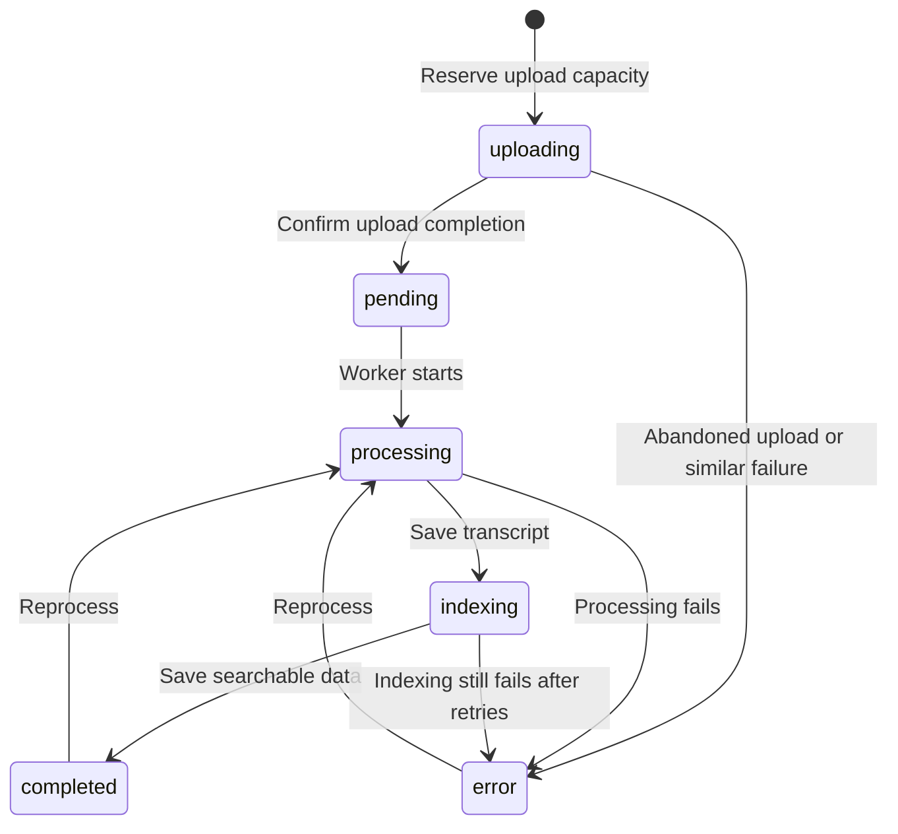

# Video states and processing completion

A video's `status` indicates progress through upload, transcription, and search preparation. Refer to it when implementing waiting states or investigating stalled processing.

## Normal flow

This diagram shows processing states, not a user-facing button for every arrow. Some registration paths, such as YouTube imports, skip file upload.

| Value | What it means or waits for | Where to check |
|---|---|---|
| `uploading` | File upload and completion notification | Browser, storage, API |
| `pending` | Transcription to start | Queue delivery, worker |
| `processing` | Audio-to-text conversion and related work | Worker, Whisper |
| `indexing` | Building searchable subtitle data | Worker, embedding API, DB |
| `completed` | Video is ready for search | Add it to a course and ask questions |
| `error` | A stage failed | Error details and relevant logs |

Also inspect individual implementations for paths such as reindexing. Normal transition definitions are in [video_status.py](https://github.com/videoq-jp/videoq/blob/main/apps/worker/worker_python/video_status.py); indexing completion is handled in [tasks/indexing.py](https://github.com/videoq-jp/videoq/blob/main/apps/worker/worker_python/tasks/indexing.py).

**Related:** [Stalled processing](../guides/troubleshooting.md).

## Search indexing outcomes

The scene-index application workflow returns a discriminated result rather than
throwing for an expected state. The queue adapter converts unsuccessful results
to typed errors, preserving retry/DLQ behavior and emitting safe diagnostic codes.
I/O failures still propagate unchanged to that boundary. Public video statuses
and the adapter's numeric scene-count contract remain unchanged.

| Result | Meaning and next action |
|---|---|
| `completed` | Publication and requested readiness confirmation succeeded; return scene count |
| `skipped` | Source was removed or work already completed; return zero without provider work |
| `pending_delivery` | Publication exists but is not confirmed searchable; retry without re-embedding |
| `source_changed` | A revision fence failed at start, stage, publish or finish; retry from fresh source |
| `not_ready` | The source is outside the required indexing state; preserve retry for reconciliation |
| `invalid_transcript` | Empty without explicit clear intent, malformed SRT or empty split; investigate |
| `invalid_embeddings` | Provider returned a different number of rows; never stage that batch |

These results do not replace atomic persistence checks. Source revision, owner,
run identity, stage/publication fences and readiness checks remain enforced by
the repositories. A failed result is not an automatic transaction rollback or
permission to acknowledge an incomplete queue delivery.
