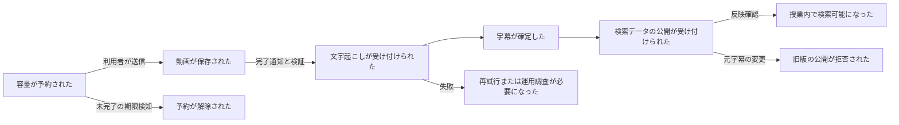

# Engineering Video Skillsによる改善レビュー

調査日: 2026-11-24。対象: このワークスペースのコード、テスト、CI、設計・運用文書。ベースコミット: `007b4f96`。既存の `package-lock.json` の変更はそのまま保持した。

`/Users/yukiharada/engineering-video-skills/skills/` の全10個のSKILL.mdと同梱出典メモを読んで適用した。これらは講演から独自に再構成されたDRAFTであり、登壇者の公式見解ではない。本レビューは動画全編の再視聴ではない。

## 結論と優先順

既にPorts/Adapters、純粋な業務ポリシー、Outbox、実行リース、両DBの契約テスト、境界の自動検査が存在する。「クリーンアーキテクチャを導入する」という提案を重ねる段階ではない。次は、実装間の契約差と運用時の説明可能性を改善する。

P1は次に取り組む候補、P2は計測・仕様確認後、P3は効果を見て判断する候補。緊急障害・重大な脆弱性を意味する分類ではない。

| ID | 優先 | 改善ポイント | 判断の強さ | 主なSkill |
|---|---|---|---|---|
| 01 | P1 | TypeScript/Pythonのジョブ入力契約を統一 | 挙動差を再現 | functional-domain-modeling |
| 02 | P1 | ジョブ失敗を安全なコードで分類し相関付け | ログ実装で確認 | sqs-lambda-processing |
| 03 | P1 | Consumerの実通信試験に障害ケースを追加 | 対象試験の不足を確認 | legacy-tdd |
| 04 | P2 | オンプレのバッチ取得と実行期限をそろえる | 設定上の条件付きリスク | sqs-lambda-processing |
| 05 | P2 | 生産側JobMessageを種類別payloadのUnionにする | 型定義で確認 | functional-domain-modeling |
| 06 | P2 | 処理状態と再試行判断を明示的な結果で表す | 設計改善候補 | functional-domain-modeling |
| 07 | P2 | 原子的ポリシーの共通実装を差分・境界値で検証 | 追加保証の候補 | clean-architecture-boundaries |
| 08 | P2 | 動画受付から検索可能になるまでの業務モデルを補う | 現行図との差を確認 | event-storming-workshop |
| 09 | P2 | D1移行判断を最新の受入条件と証跡に集約 | 文書に未達条件あり、現状照合が必要 | data-system-design |
| 10 | P2 | 深いOFFSETの影響を実測し、必要な経路だけ改善 | SQL形状を確認、遅延は未測定 | database-performance-diagnosis |
| 11 | P2 | CORS診断をブラウザーの実動作まで広げる | 診断範囲の限界を確認 | cors-diagnosis |
| 12 | P3 | 変更が集中する画面・組み立てコードを小さく整理 | 大きさは確認、効果は要計測 | quality-and-delivery |
| 13 | P2 | 追加サービス分割の前に所有責務と共有DB契約を明文化 | 設計判断の候補 | microservice-migration |

## 01: ジョブ入力契約に実装差がある

根拠:

- [TSパーサー](../apps/api/src/application/background-job.ts#L10)は、envelopeの未知フィールドを拒否し、`delete_account_data.payload.user_id`を128文字以下に限定する。
- [Python payload検証](../apps/worker/worker_python/domain/jobs.py#L62)はuser_idの長さを制限していない。
- [Python実行入口](../apps/worker/worker_python/use_cases/job_execution.py#L21)はenvelopeの未知フィールドを拒否していない。
- [既存の同一性テスト](../apps/api/test/background-job.test.ts#L10)は固定文字列を比較する。両言語のパーサーを同じ入力集合で実行する試験ではない。

外部接続なしのprobeで、129文字のuser_idとenvelopeへの`unexpected: true`の追加は、どちらもTSで拒否、Pythonで受理となった。実際にこの入力が本番で生成されていることや、ユーザー障害が起きたことまでは示さない。

改善: 両処理系が担当する共通ジョブ種別について、言語非依存のJSON fixtureで「受理・拒否・正規化・ハッシュ」を照合する。Unicode、空白、整数境界、未知キー、必須キー欠落も含める。未知フィールドを許すかは契約として選び、片側だけ変更しない。実行環境ごとの担当ジョブ種別の違いは保持する。

完了条件: 同じ対象入力集合について両言語の判断が一致し、既存メッセージの再送でもjob identityが変わらない。

## 02: 機密を守りながら失敗原因を判別できるようにする

根拠: [Lambda入口](../apps/worker/worker_python/lambda_handler.py#L43)は失敗時にmessageIdだけを記録し、[実行ユースケース](../apps/worker/worker_python/use_cases/job_execution.py#L60)は保存する失敗コードを`WORKER_EXECUTION_FAILED`に統一する。[Node Consumer](../apps/api/src/integrations/background-jobs/sqs-consumer.ts#L34)もretryイベントにgroupだけを記録する。

例外文に署名URLや秘密情報を出さない方針は維持する。その上で、不正payload、identity競合、lease busy、外部429/5xx、DB停止、期限超過を判別できないと、修復や再投入の判断に時間がかかる。

改善: 許可リスト方式の`error_code`と`retryable`、処理段階、job_id・messageIdの相関、試行回数、所要時間を構造化する。user_idや本文、例外の生文字列は追加しない。不正メッセージは既存DLQへ到達させる方針を維持し、原因分類だけで成功扱いに変えない。

完了条件: 合成障害の各分類がログから区別でき、署名URL・token・字幕がログに混入しないことをテストする。

## 03: Consumer境界の失敗試験を増やす

既存の[ジョブRepository契約](../apps/api/test/persistence/contracts/job-repository.contract.ts)は並行claim、完了済み再送、旧lease排除を検証する。[実SQS互換通信試験](../apps/api/test/sqs-background-consumer.integration.test.ts)は成功した1件の実行と削除が中心。[NodeプロセスE2E](../apps/api/test/background-worker.e2e.test.ts)には完了後の重複配送もある。これらを作り直す必要はない。

追加する境界ケース:

1. 副作用とDB上の完了が成功した直後、DeleteMessageだけが失敗する。再配送で副作用が繰り返されないこと。
2. 下流AIまたはDBが停止し、復旧後に同じjob_idが完了すること。
3. busy/conflict/不正payloadが削除されず、所定の可視性変更・再試行になること。
4. 実行中のSIGTERM、期限超過、ChangeMessageVisibilityの失敗で未完了メッセージをACKしないこと。

Consumerの入出力を保護し、時計・通信の狭い差し替え箇所で再現する。既存単体テストの全パターンを実サービス試験へ重複させず、実通信でしか保証できない部分へ絞る。

## 04: オンプレの取得バッチと期限の単位を合わせる

根拠: [Python poller](../apps/worker/scripts/run_worker.py#L62)は`SQS_MAX_MESSAGES`を最大10へ設定できるが、実行期限のtimerはバッチ全体に1回設定する。handlerはメッセージを順次処理する。

既定値1では問題が顕在化しない。値を増やすと、各ジョブが個別には期限内でも、バッチ合計で840秒を超え得る。期限超過時には既に成功したメッセージも削除されず、再配送される。完了済みジョブのリース機構は副作用の再実行を抑止するが、余分な再配送や後続の待ち時間は発生する。

改善: 重い媒体ジョブは取得数1に制限するか、メッセージごとの期限・成功分の削除・待機中メッセージの可視性を一緒に設計する。取得数だけを増やして高速化しない。

完了条件: 複数件の合計時間が期限を超える合成ケースで、成功分と未着手分の扱いが仕様通りになる。

## 05: 生産側にも種類別payloadの型を持たせる

根拠: [JobMessage](../apps/api/src/application/job-message.ts#L21)は`type: JobType`と`payload: Record<string, unknown>`の組であり、ジョブ種別とpayloadの対応を型として保証しない。一方、共通バックグラウンド処理には種類別Unionが既にある。

改善: producerのJobMessageも判別可能Unionとし、動画ID、run_id、chunk_indexの組み合わせを種類別に限定する。保存済みJSONとキュー入力には実行時検証を残す。契約生成を採用するなら依存のない共有仕様から行い、domainへZodやRPCを逆流させない。

完了条件: `delete_account_data`にvideo_idだけを渡すコードがコンパイルで拒否される。旧メッセージの互換性も01のfixtureで検証する。

## 06: 再試行を要求する状態と障害を分ける

根拠: [scene indexing](../apps/api/src/application/scene-index-execution.ts)では、未反映、source変更、SRT不正、embedding件数不一致などが例外で表される。[VideoStatus](../apps/api/src/application/models.ts)と[Python Enum](../apps/worker/worker_python/domain/video_status.py)は状態名の集合を表すが、操作ごとの前提条件を型で完全に表すものではない。

改善: まずscene indexingの1ユースケースで、`completed / pending_delivery / source_changed / invalid_transcript`等の想定結果をUnionで返す。I/O失敗は境界で扱い、再試行ポリシーへ変換する。uploading状態でだけ必要な予約情報などは、更新用の小さな状態型で表す案を比較する。

読み取りDTOや全CRUDを状態別型へ変える必要はない。DB保存時のCAS・revision・トランザクションは維持し、型だけで競合を解決した扱いにしない。

## 07: 純粋ポリシーとSQL実装の意味が一致する保証を強める

現行の業務層はフレームワークから分離されており、今回の境界テストも成功した。[返金ポリシー](../apps/api/src/application/video-mutation.ts)にはboolean評価とSQL評価があり、[SQL側](../apps/api/src/persistence/video-mutation-policy-sql.ts)で原子的更新へ組み込める。これは保持すべき設計である。

改善候補: 状態、NULL、0、負数、月境界、期限の等号などの入力表を使い、純粋関数とPG/D1の実更新結果を差分比較する。既存の両DB契約テストへ不足する境界値だけを足す。ポートを追加するより、同じ意味で評価される保証へ投資する。

完了条件: 代表的な返金・クォータ・期限切れの判断が両DBで一致し、並行更新時にも既存の不変条件が守られる。

## 08: 業務イベントと判断のモデルを補う

[責務図](architecture/bpmn.md)はUser/API/Workerの技術的な流れを説明し、[ジョブ復旧図](architecture/flowchart.md)と[状態図](design/state-diagram.md)は別の詳細を持つ。これに、利用者が何を見て何を判断するか、失敗・取消時に何を保証するかを結ぶモデルを追加すると改善判断に使いやすい。

コードから置いた仮説モデル。業務担当者との合意済みモデルではない:



Hot Spotとして確認する事項: 「完了」は検索反映済みか、失敗時の処理枠返却はどの段階までか、再処理中に旧版を見せるか、取消と処理が競合した時にどちらを優先するか。回答は既存実装・仕様と照合し、未合意の変更は提案として残す。

## 09: D1移行を、最新候補の受入条件で判断する

[本番readiness文書](operations/d1-production-readiness.md)には、性能、費用、外部状態を含む復旧、最終候補E2E等の未達条件が記録されている。[検索性能](operations/d1-same-worker-scene-performance.md)と[認証付き参照API](operations/d1-authenticated-api-performance.md)は異なる経路・条件の証拠なので、片方の改善を全体へ一般化しない。この文書は過去時点の記録であり、現在の本番構成を今回ライブ確認したものではない。

改善: 最新候補SHA・配置・モデル・データ規模・cold/warm・並行度・試験日時・品質・費用・復旧範囲を一つの受入表に結ぶ。既存証跡を再利用し、変更で無効になった条件だけ再測定する。RAGと参照APIのSLOは個別に業務上の目標を設定する。

完了条件: 採用条件と撤退条件を事前に説明でき、切り戻し演習が対象となるDB・オブジェクト・検索・キューの範囲を明記する。今回、本番移行やリソース変更は実施していない。

## 10: 深いページの性能は測ってから改善する

根拠: [チャット履歴](../apps/api/src/persistence/postgres/chat-repository.ts#L605)は`created_at DESC, id DESC`とLIMIT/OFFSET、[コース一覧・メンバー](../apps/api/src/persistence/postgres/course-repository.ts)にもOFFSETがある。順序には既にtie breakerがある。遅延やIndex不足は今回実測していない。

改善手順: 代表的tenant規模で浅い/深いページを比較し、対象SQL、回数、合計負荷、p95、通常EXPLAINを記録する。隔離DBで必要ならEXPLAIN ANALYZE/BUFFERSを取得する。読取り量の増加が確認された経路だけ、cursor方式やIndexを比較する。

cursor化は公開MCPのoffset契約やページ飛越しに影響する。新しいcursor契約を追加するか、内部バッチから適用する。SQLを見ただけでIndexを増やさない。

## 11: CORSの設定検査とブラウザー成功を区別する

[API middleware](../apps/api/src/middleware/cors.ts)はCookie用Origin制限とMCPのwildcard/credentialsなしを分けている。[MCPテスト](../apps/api/test/mcp.test.ts#L687)はpreflight・401ヘッダーを検証し、Garageにも実HTTPの試験がある。

一方、[オンプレdoctor](../scripts/onprem/videoq.py#L293)の公開経路チェックはPython urlopenによるready/OPTIONSとACAO照合である。ブラウザーによるCORS判定、署名PUT、ETagのJSからの読取り、multipart完了までを証明しない。

改善: doctorの成功表示を実際の検査範囲へそろえ、追加のブラウザー受入試験で許可/不許可Origin、実際のPUTヘッダー、ETag、エラー応答、Cookie付きAPI、外部MCPを確認する。APIとstorageで判定する層を分け、実URLとOriginを記録する。

今回ブラウザー操作は実施していない。CORS障害の存在を断定する指摘ではなく、受入検証の追加提案である。

## 12: 小さな整理の効果を変更時間で測る

[SettingsPage](../apps/web/src/pages/SettingsPage.tsx)は817行、[AdminPage](../apps/web/src/pages/AdminPage.tsx)は750行で、設定画面にはAPIキー・検索キー等の独立した状態が集まる。[persistence factory](../apps/api/src/persistence/factory.ts)は557行で、両DBの組み立てを担う。行数だけで設計不良とは判断しない。

改善: 次に該当機能を変更する時、SettingsのAPIキー節のようなまとまりを既存画面テストで保護して抽出する。factoryは実際に同時編集や配線漏れが起きるなら責務別に分ける。DIコンテナや大量の生成コードは先に追加しない。

品質・速度の指標として、変更箇所の理解時間、最初のテスト結果までの時間、PR手戻り、CI待ち時間を短期間記録する。CIは既に変更範囲選別とjob分割があるため、再構築より重複install等の実測から改善する。開発・CI・受入で同じチェックを再利用し、学習時間を圧迫する大規模一括変更は避ける。

## 13: サービス追加分割より、所有責務と互換契約を先に置く

現行はAPI、Python media worker、Node background worker、推論基盤などが既に分離される。[PythonのDBジョブ管理](../apps/worker/worker_python/job_execution.py)と[TSのDBジョブ管理](../apps/api/src/persistence/postgres/job-repository.ts)は同じjob_executions契約を利用する。独立したプロセスであることと、自由に独立リリースできることは異なる。

改善: 「教材取り込み」「受講・アクセス」「質問応答」「課金・利用枠」の論理責務ごとに、書込み主体、認可の決定元、同期で守る不変条件、遅延を許す反映、障害対応の所有者を表にする。担当者・チーム構成は今回確認しておらず、独立運用できるとは仮定しない。

物理分割は独立スケールやリリース競合の実測がある時に検討する。移行する場合は一つの操作を切替点とし、旧/新consumerの担当、キュー内の旧payload、DB migration順、drain、切戻し条件をそろえる。01の契約試験を先に整える。

## 推奨する着手順

1. 01・05: 共通ジョブfixtureとproducer型を整える。最初の差分は契約の現状記録、次の差分で意図する仕様へそろえる。
2. 02・03・04: 安全な失敗分類を追加し、実通信と期限の障害試験を整える。
3. 08・06・07: 取込みフローの不変条件を整理し、一つの状態遷移から型と境界値検証を強める。
4. 09・10・11: 最新候補で未達の受入条件と性能・ブラウザー検証を埋める。
5. 12・13: 変更コストと運用責務の根拠が得られた範囲で構造を整理する。

## 今回の検証と限界

- `npm run test:unit --workspace @videoq/api -- test/background-job.test.ts test/architecture-boundaries.test.ts test/mcp.test.ts --maxWorkers=2`: **3ファイル、57テスト成功**、所要8.26秒。
- TSは既存tsx、Pythonは`/opt/homebrew/bin/python3.14`で副作用のない契約probeを実行。01の2入力で受理/拒否の差を再現した。claimは完了済み相当のスタブとし、DB・キュー・外部APIは呼んでいない。
- 最初のPython probeはPATH上の旧Pythonで型注釈の読み込みに失敗したため、Python 3.14で再実行した。プロジェクトの不具合とは扱っていない。
- フル回帰、DB実行計画、負荷試験、本番状態、実ブラウザーCORS、外部AIは今回未検証。過去の証跡と今回の成功結果は区別した。
- アプリコードは変更していない。追加成果物はこのレビュー文書のみ。

## 実装対応の進捗（2026-11-24）

対応は [PR #1672](https://github.com/videoq-jp/videoq/pull/1672) で進めている。
以下の「実装・検証済み」はローカルの根拠であり、マージ・本番配備完了を意味しない。
Issueはマージ前のため開いたままにする。既存のpackage-lock.jsonの変更は含めない。

| 項目 | Issue | 実装状況と根拠 |
|---|---|---|
| 01 | [#1659](https://github.com/videoq-jp/videoq/issues/1659) | 実装・検証済み。08b2a111。58共通fixture、TS/Pythonの受理・hash・再送照合 |
| 02 | [#1660](https://github.com/videoq-jp/videoq/issues/1660) | 実装・検証済み。ff50c477。安全な障害分類と相関ログ、秘密情報非出力 |
| 03 | [#1661](https://github.com/videoq-jp/videoq/issues/1661) | 実装・検証済み。48c221e9。専用PG/ElasticMQの9障害ケースと実SIGTERMのプロセスE2E |
| 04 | [#1662](https://github.com/videoq-jp/videoq/issues/1662) | 実装・検証済み。db122220。媒体取得数1を起動時検証し、独立した実行期限を保証 |
| 05 | [#1663](https://github.com/videoq-jp/videoq/issues/1663) | 実装・検証済み。ad5fade5。全11種別のpayload Union、相関tuple、compile-only拒否テスト |
| 06 | [#1664](https://github.com/videoq-jp/videoq/issues/1664) | 実装・検証済み。9fd20173。想定結果のUnion、I/O失敗の保持、既存D1境界を含む77件成功 |
| 07 | [#1665](https://github.com/videoq-jp/videoq/issues/1665) | 実装・検証済み。820881a0。各DBで144入力の実UPDATE照合、月/期限境界と二重返金のmutation試験36件成功 |
| 08 | [#1666](https://github.com/videoq-jp/videoq/issues/1666) | [業務モデル](architecture/bpmn.md)を追記。イベント因果・判断材料・責務・Hot Spotを整理し、未合意を明記 |
| 09 | [#1667](https://github.com/videoq-jp/videoq/issues/1667) | 受入表を現行D1/768次元構成へ更新。比較元SHAとCD、品質/性能の測定条件、未測定のSLO/費用、復旧対象と旧資源の廃止を区別。英日docs build成功 |
| 10 | [#1668](https://github.com/videoq-jp/videoq/issues/1668) | 実装・検証済み。実PG RepositoryのSQL/EXPLAIN/60標本を保存。深いページだけID先行取得し、既存順序Indexへidを追加。公開offset・認可・投稿者表現を維持 |
| 11 | [#1669](https://github.com/videoq-jp/videoq/issues/1669) | 実装・検証済み。doctor表示をready/OPTIONSへ限定。実ブラウザー15項目とサーバー側の送信有無を保存 |
| 12 | [#1670](https://github.com/videoq-jp/videoq/issues/1670) | 実装・検証済み。APIキーの状態・通信・dialogを抽出。既存33テスト/11storiesと計測記録 |
| 13 | [#1671](https://github.com/videoq-jp/videoq/issues/1671) | [責務・互換・段階移行契約](architecture/responsibility-and-release-contract.md)を記録。所有者は役割と未割当を区別し、追加分割は根拠が揃うまで保留 |


## 10の実測と採用判断（2026-11-24）

[比較前の全SQL・計画・集計](verification/chat-pagination-2026-11-24-before.json)と
[比較後](verification/chat-pagination-2026-11-24-after.json)を保存した。PostgreSQL 17.11の
専用loopbackコンテナを使い、実際の`createPostgresChatRepository().history()`を呼ぶ。
各規模で対象講座と同数の無関係な講座の行を入れ、同じ時刻が3行続く合成データとした。
250件は小規模、1万/10万件は成長時のストレス条件であり、現在の本番分布を取得したものではない。
本文は合成で、講義・利用者の実データや資格情報は記録していない。

VACUUM ANALYZE、ページごと2回のwarmup後、浅い/中間/深いページを順序反転して交互に
各60回測定した。1回2 SQL（owner/count確認とpage取得）を維持。p95はnearest-rank、
p99はこの標本数では最大値。常時warm・逐次・ローカルpoolのRepository時間であり、
本番・cold・同時負荷・認証middleware・画面応答のSLOではない。Mac上の他の負荷は制御していない。

| 対象講座の件数 | offset | 比較前p95 ms | 比較後p95 ms |
|---|---:|---:|---:|
| 250 | 0 | 2.11 | 1.11 |
| 250 | 125 | 2.49 | 1.76 |
| 250 | 230 | 3.27 | 1.48 |
| 10,000 | 0 | 1.52 | 2.83 |
| 10,000 | 1,000 | 2.97 | 3.17 |
| 10,000 | 5,000 | 5.72 | 2.61 |
| 10,000 | 9,980 | 14.02 | 3.39 |
| 100,000 | 0 | 5.77 | 5.74 |
| 100,000 | 1,000 | 6.83 | 5.44 |
| 100,000 | 50,000 | 46.35 | 7.53 |
| 100,000 | 99,980 | 110.45 | 9.38 |

採用した変更は次の組み合わせである。

- offset 1000未満は従来のSQL形状を保つ。深いページは先にIDのページを確定し、回答本文・投稿者・LTI attributionを取得する。
- 既存の`chat_logs_course_created_idx`を`(course_id, created_at DESC, id DESC)`へ置換する。既存の安定順序へ合わせ、ID取得をIndex Only Scanにする。Index本数は増やさない。
- 本文等のJOINを行う行数は、10万件の最終ページで10万行から20行へ減った。前はwide rowのexternal merge、後はページIDのIndex Only Scanと20行のquicksortを実行計画で確認した。
- 先にIDを読むだけの試作も比較したが、中間ページに不安定な悪化があった。Indexの順序を合わせた上で採用し、試作の最良値だけを採用根拠にしていない。

小さいページのp95には悪化もあり、全経路の一律な高速化は主張しない。一方、10万件の
最終ページは110.45→9.38ms、中間は46.35→7.53msとなり、JOIN/sort量の削減も確認できた。
公開のoffset/limit/count、所有者確認、同時刻のID順、投稿者匿名性、LTI attribution、
CSVの既存cursor契約は維持する。全件countとOFFSET自体は残るので、計算量が定数になったわけではない。

### 書込み・容量・配備への影響

同じ合成データで、計測後に20行ずつのINSERTを60回実行した。10万件講座+無関係10万件で、
当該Indexは7,061,504→14,491,648 bytes。20行INSERTのp50は0.44→0.73ms、
p95は1.45→1.84msであり、読取りの改善には容量と書込みの増加が伴う。
他規模の結果もJSONへ保存した。これは単独・短期の合成測定で、実アプリの書込み負荷や月額費用へ外挿しない。

変更はPostgreSQLのこの履歴経路と順序Indexに限る。D1・コース一覧・MCP契約を一括変更しない。
DDLはDrizzleから生成した`0066_chat_history_page_order.sql`を使用する。
既存IndexのDROP/CREATEを含むため、オンプレ更新時は既存の移行手順で書込みを止め、
データ量に応じた移行時間を確認する。本番DBで今回DDL・負荷試験を実行していない。
実PGの履歴/投稿者/深いページと全migration適用の30テスト、型検査、lint、db:check/db:verifyで検証する。

再計測（専用のloopback PostgreSQLだけを指定する。生成schemaはfinallyで削除される）:

```sh
PAGINATION_BENCH_DATABASE_URL=postgresql://...@127.0.0.1:PORT/postgres \
PAGINATION_BENCH_INDEX=ordered PAGINATION_BENCH_SAMPLES=60 \
node_modules/.bin/tsx apps/api/scripts/benchmark-chat-pagination.mjs /private/after.json
```

旧SHAのRepositoryと`PAGINATION_BENCH_INDEX=legacy`が比較前条件。
記録の`repositorySha256`と`scriptSha256`で実際に測定したソースを識別する。
公開結果を再現するために稼働中のDBや旧providerを利用する必要はない。

実行計画の読み方は[PostgreSQL 17 EXPLAIN](https://www.postgresql.org/docs/17/using-explain.html)、
OFFSETの性質は[同LIMIT/OFFSET](https://www.postgresql.org/docs/17/queries-limit.html)を参照。

## #11 CORS受入の実施結果

専用Garage 2.5.0と実Hono CORS middlewareを使い、異なるportの許可/不許可Originを
ego-browser（Chromium 156）で検証した。許可10、不許可5項目が成功し、
不許可JSON POST/署名PUTの本体未送信と、GarageのOPTIONS 403も記録した。
署名PUTのETag読取り、multipart 2partのETag取得・完了・5,242,917 bytesの
SHA-256照合、API 500/署名エラー403の読取りを含む。Cookie用のOrigin制限と
外部MCPのcredentials omit/wildcard/challenge公開を区別した。

[匿名化した通信証跡](verification/cors-browser-2026-11-24.json)と
[再実行手順](../infra/garage/README.md#browser-cors-acceptance-across-two-origins)を保存。
doctorの表示はPythonが実際に確認するready・OPTIONSへ合わせた。
既存のCORS設定変更は不要だった。Cookie/MCPは合成routeであり、完全な認証flowや
本番TLS/CDN経路の受入完了を意味しない。lintとオンプレCLIの14テストも成功。

## #12 Settingsの責務整理

IntegrationApiKeysSectionへAPIキー管理を抽出。秘密値を親や一覧cacheへ渡さず、
作成・失効・コピーの状態と非同期競合を一か所に置いた。既存33テスト、
11stories、型検査、lintが成功。ego-browserで日本語dialogの作成・コピー失敗と
再試行・閉じた後の秘密値消去を確認し、英語storyも表示した。
[測定・制約・次の評価期間](verification/settings-refactor-2026-11-24.md)に、
初回結果待ち、CI待ち、未計測の人の理解時間/手戻りと採用しなかった施策を記録した。

## #13 所有責務と共有契約

[責務・リリース契約](architecture/responsibility-and-release-contract.md)に、教材取込・
受講/アクセス・質問応答・課金/利用枠の書込み主体、認可、不変条件、遅延と運用役割を整理。
実在の担当者・業務上の許容遅延は未確認と明記した。共有job ledgerのidentity/hash/lease、
旧payload、expand/contractとリリース順を記録し、scene indexingを例に切替・drain・
観測・切戻し・旧実装廃止の条件を示した。追加分割は計測根拠と独立運用の責任が
揃うまで見送る。実移行・配備は行っていない。システム概要の英日旧構成も現行へ更新した。
