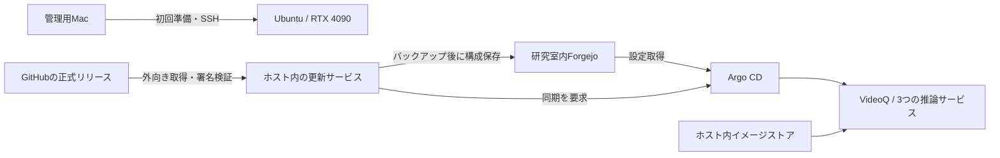

# 後輩向け：RTX 4090 1枚のVideoQを空のサーバーから立ち上げる

対象は、MacからSSH接続できる専用Ubuntuサーバーを管理する人です。AnsibleやKubernetesの経験は前提にしません。
研究室のLAN内で使う場合と、Vast.aiで練習する場合を分けて説明します。
**コード枠は一行ずつ実行し、コマンドが失敗したら次のコマンドには進まないでください。** Pythonの`PY`で囲まれた部分は、開始行から終了行までをまとめて貼り付けます。

2026-11-13に、空のUbuntu VM・RTX 4090 1枚で手動導入、ブラウザでの動画投入・引用再生、
正式リリースの更新、更新後の既存動画の再生まで確認した作業を元にしています。
この手順書の汎用化したサンプルは、その検証で使ったものから作成しました。
研究室の実機での導入、負荷試験、このサンプルを使った別ホストへの完全復元は未検証です。

## 完成するとどうなるか



- **Ansible**：初回のOS周辺・GPU実行環境・K3s・Argo CDを準備する。
- **K3s**：この1台でアプリを動かす軽量Kubernetes。
- **Forgejo**：研究室の設定を保存する非公開Gitサーバー。本体のGitHubとは別。
- **Argo CD**：Gitに保存した設定を実際のアプリに反映する。
- **更新サービス**：約15分間隔で正式リリースを確認し、署名検証、イメージ保管、バックアップ、反映、動作確認を行う。

GitHubアカウント、GitHubへの書き込み権限、公開の採用版登録PRは不要です。
公開リリース・イメージ・モデルの取得には外向きのインターネット接続が必要です。
研究室への外部からのWebhookや、Git・Argo CDのインターネット公開は不要です。
アプリ更新は自動ですが、OS・GPUドライバー・K3s・Argo CDの保守は別作業です。

## 0. 用意するものと引き継ぎメモ

| 項目 | 用意するもの |
| --- | --- |
| サーバー | 専用Ubuntu 22.04/24.04 amd64、RTX 4090 24GB 1枚、systemdが動くVMまたは実機 |
| メモリー | 64GB程度を推奨。今回の検証VMで実際に見えた容量は約49GiB |
| ディスク | 初期検証は約97GiBで実施。継続運用は200GB以上など、動画・モデル・旧イメージ・バックアップ分の余裕を用意する |
| 管理用PC | この手順はMac、Git、Python 3.14、Helm、Google Chromeを使用 |
| 権限 | SSH接続と、rootまたはパスワードなしsudo。コマンド例はリモート側でsudoを使用 |
| 承認済みコード | 運用担当が指定した40桁のコミットSHA。mainを毎回無条件にrootで実行しない |
| 動作確認動画 | 自分で用意した、音声入り10〜30秒の小さなMP4。秘密の研究データを使わない |

Vast.aiではコンテナ型ではなく、systemd/K3sを使えるUbuntu **VM** を選びます。
レンタル開始・停止・料金確認はVast.aiの画面で行い、VM IDを控えてください。
GPUを使う作業の直前に起動し、ローカル作業やCI待ち、検証終了時には停止します。
Stopでも保存料金は残ります。Destroyはディスクを失う操作です。

次の表をパスワードを含まない引き継ぎメモに記録します。例のIPをそのまま使わず、実際の値に置き換えてください。

| 設定 | 研究室の例 | Vast.aiの例 |
| --- | --- | --- |
| SSHの別名 | `lab4090` | `videoq-practice` |
| SSH接続先 | 管理用LAN IP | Vastに表示される外部IP・SSHポート |
| VideoQのLAN IP | `192.168.1.50`（固定・DHCP予約） | VM内のIPv4。今回の検証は`10.0.2.15` |
| site | `lab` | `practice` |
| public URL | `https://192.168.1.50` | `https://10.0.2.15` |
| Git URL | `ssh://git@192.168.1.50:2222/operator/lab-config.git` | `ssh://git@10.0.2.15:2222/operator/lab-config.git` |

Vaultパスワード、SSH秘密鍵、暗号鍵、管理者・検証アカウントのパスワードは、研究室指定のパスワード管理先へ保管します。
設定リポジトリや共有チャットには入れません。Vaultと、その復号パスワードは別に保管します。

## 1. Macと作業フォルダーを準備する（VM停止中でもできる）

Homebrewが導入済みのMacを想定します。組織で管理している同等のツールでも構いません。

```bash
brew install python@3.14 helm git ffmpeg
mkdir -p ~/videoq-lab/keys
chmod 700 ~/videoq-lab ~/videoq-lab/keys
cd ~/videoq-lab
git clone https://github.com/videoq-jp/videoq.git
cd videoq
# 運用担当から受け取った、手順書・サンプルを含む承認済みSHAへ置換する
export VIDEOQ_CODE_SHA=REPLACE_WITH_REVIEWED_40_CHARACTER_SHA
git switch --detach "$VIDEOQ_CODE_SHA"
"$(brew --prefix python@3.14)/bin/python3.14" -m venv .venv
source .venv/bin/activate
set -o pipefail
python -m pip install --upgrade pip
python -m pip install -r infra/ansible/requirements.txt PyYAML==6.0.3
python --version
ansible-playbook --version
helm version --short
```

**成功条件**：AnsibleのPythonのパスがこの`.venv`配下で、指定したPythonを使っている。
`ansible-core==2.21.6`が見つからない場合は、まず`python --version`を確認します。
Mac標準の古いPythonでvenvを作らないでください。Helmは今回v4.3.1で検証しました。
既存のvenvを作り直す場合は削除せず別名で退避し、上の明示的なPythonで作り直します。

以後、**メインのターミナル**で変数を設定します。別ターミナルには自動では引き継がれません。

```bash
export VIDEOQ_WORK="$HOME/videoq-lab"
export VIDEOQ_HOST=lab4090
export VIDEOQ_IP=192.168.1.50
export VIDEOQ_SITE=lab
export VIDEOQ_PUBLIC_URL="https://$VIDEOQ_IP"
export VIDEOQ_GIT_URL="ssh://git@$VIDEOQ_IP:2222/operator/lab-config.git"
```

VastではHOST、IP、SITEを先ほどの表の実際の値に変えます。
ターミナルを閉じたら、この変数設定と`source ~/videoq-lab/videoq/.venv/bin/activate`を再実行します。

## 2. SSHとGPUを確認する（ここからサーバーを起動）

Macの`~/.ssh/config`に接続情報を追記します。既存設定は消しません。

```sshconfig
Host lab4090
    HostName REPLACE_WITH_SSH_ADDRESS
    User ubuntu
    Port 22
    IdentityFile ~/.ssh/id_ed25519
    IdentitiesOnly yes
    ServerAliveInterval 30
    ConnectTimeout 15
```

Vastの例ではHostを`videoq-practice`、Userを`root`、PortとHostNameをVastの表示値にします。
IdentityFileは実際に登録した鍵です。最初の接続では、管理者・提供元から得たSSHホスト鍵と照合します。

```bash
ssh "$VIDEOQ_HOST" 'hostname; nvidia-smi; sudo -n true; ip -4 -brief address; df -h /'
ansible all -i "$VIDEOQ_HOST," -m ansible.builtin.ping
```

**成功条件**：RTX 4090が1枚表示され、sudoとAnsible pingが成功する。
`ip`の結果でVideoQ用IPが実際に割り当てられていることも確認します。
Python interpreter discoveryの警告だけなら失敗ではありません。表示されたPythonパスを次のinventoryに固定します。
GPUドライバーが無い実機の準備は[詳細手順](lab-gitops.md#2-ansible-で初回準備する)を参照してください。
既存のGPUドライバーが壊れている場合、再起動を繰り返さず管理者へ相談します。

## 3. inventoryと暗号鍵を作り、初回Ansibleを実行する

`videoq/`で実行します。リモートPythonは前節の結果へ置き換えてください。

```bash
python - <<'PY'
import os
from pathlib import Path
import yaml
host = {
    'ansible_python_interpreter': '/usr/bin/python3.10',
    'videoq_public_url': os.environ['VIDEOQ_PUBLIC_URL'],
    'videoq_gitops_repository': os.environ['VIDEOQ_GIT_URL'],
    'videoq_gitops_revision': 'main',
    'videoq_gitops_path': 'clusters/' + os.environ['VIDEOQ_SITE'] + '/apps',
    'videoq_update_enabled': False,
}
data = {'all': {'children': {'videoq': {'hosts': {os.environ['VIDEOQ_HOST']: host}}}}}
path = Path('infra/ansible/inventory.local.yml')
if path.exists():
    raise SystemExit('既存inventoryがあります。内容を確認し、上書きせず編集してください')
path.write_text(yaml.safe_dump(data, sort_keys=False))
PY
cd infra/ansible
ansible-inventory -i inventory.local.yml --graph
```

初回のみ暗号鍵を作ります。**再実行時に暗号鍵を再生成しない**でください。

```bash
python -c 'from cryptography.fernet import Fernet; print("videoq_credentials_encryption_key: " + Fernet.generate_key().decode())' \
  | ansible-vault encrypt --output vault.local.yml
chmod 600 vault.local.yml
head -n 1 vault.local.yml
ansible-playbook -i inventory.local.yml site.yml -e @vault.local.yml --ask-vault-pass
```

**成功条件**：Vault先頭は`$ANSIBLE_VAULT;1.1;AES256`、Ansibleは`failed=0`、`unreachable=0`。
この時点ではGit認証が未設定でよく、本体も自動更新もまだ始まりません。

## 4. 同じサーバーにForgejoを準備する

既に研究室にForgejo/GitLabがある場合はそれを使い、以下の新設だけを省略します。
その場合、Git URLとホスト鍵は既存サーバーのものにしてください。

付属サンプルは、今回検証した上流Forgejo 17.0.1 rootlessのdigestを固定しています。
HTTPはホストの127.0.0.1:3000、Git用SSHは指定LAN IP:2222だけに割り当てます。
同じK3s上にありますが、アプリの更新とは独立したDeploymentです。

```bash
cd "$VIDEOQ_WORK/videoq"
ssh "$VIDEOQ_HOST" "sudo -n python3 - --listen-ip '$VIDEOQ_IP'" \
  < docs/examples/lab/forgejo-bootstrap.py
ssh "$VIDEOQ_HOST" 'sudo k3s kubectl apply -f /var/lib/videoq-forgejo/manifest.json'
ssh "$VIDEOQ_HOST" 'sudo k3s kubectl -n videoq-git rollout status deployment/forgejo --timeout=300s'
ssh "$VIDEOQ_HOST" 'sudo k3s kubectl -n videoq-git exec deployment/forgejo -- forgejo --config /var/lib/gitea/custom/conf/app.ini admin user create --username operator --email operator@example.com --admin --random-password --random-password-length 32 --must-change-password=true'
```

最後のコマンドは**初回だけ**です。表示された初期パスワードを秘密として扱い、再作成しません。
別ターミナルで、SSHの別名を実際のものに置換し、トンネルを開いたままにします。

```bash
ssh -N -L 3000:127.0.0.1:3000 lab4090
```

Macで`http://localhost:3000`を開き、operatorでログインしてパスワードを変更します。
**非公開**の`operator/lab-config`を作成します。READMEなどで初期化せず、空のリポジトリにします。
このHTTP接続はSSHトンネル内だけで使います。外部へ3000番を開けません。

## 5. Argo CD用の読み取り鍵を登録する

```bash
ssh-keygen -t ed25519 -f "$VIDEOQ_WORK/keys/argocd" -C videoq-argocd -N ''
pbcopy < "$VIDEOQ_WORK/keys/argocd.pub"
```

鍵の上書きを聞かれたら`n`で中止し、既存鍵を確認します。
Forgejoの設定リポジトリで「設定 → デプロイキー」に公開鍵を追加します。
名前は`Argo CD`、**書き込み許可は無効**です。

自分がSSH接続しているホスト経由で、Forgejoの公開ホスト鍵を取得します。
単独の`ssh-keyscan`の結果を無確認で信頼する方法は使いません。

```bash
ssh "$VIDEOQ_HOST" 'sudo k3s kubectl -n videoq-git exec deployment/forgejo -- cat /var/lib/gitea/ssh/gitea.rsa.pub' \
  > "$VIDEOQ_WORK/keys/forgejo-host.pub"
python - <<'PY' | ansible-vault encrypt --output "$VIDEOQ_WORK/keys/argocd.vault.yml"
import json, os
from pathlib import Path
root = Path(os.environ['VIDEOQ_WORK']) / 'keys'
key = (root / 'forgejo-host.pub').read_text().split()
print(json.dumps({
    'videoq_gitops_ssh_private_key': (root / 'argocd').read_text(),
    'videoq_gitops_known_hosts': '[' + os.environ['VIDEOQ_IP'] + ']:2222 ' + ' '.join(key[:2]) + '\n',
}))
PY
chmod 600 "$VIDEOQ_WORK/keys/argocd.vault.yml"
cd "$VIDEOQ_WORK/videoq/infra/ansible"
ansible-playbook -i inventory.local.yml site.yml \
  -e @vault.local.yml -e @../../../keys/argocd.vault.yml --ask-vault-pass
```

Vaultは以後も同じパスワードを使います。既存Gitサーバーでは、その管理者が確認したホスト鍵を使用します。

## 6. 正式リリースを検証し、配置設定を作る

署名検証用Pythonを明示し、公開カタログから正式リリースの識別情報を選びます。
選択後のSHA・run・attemptを変えずに検証・生成します。

```bash
cd "$VIDEOQ_WORK/videoq"
export VIDEOQ_VERIFY_PYTHON="$PWD/.venv/bin/python"
read -r RELEASE_SHA RELEASE_RUN RELEASE_ATTEMPT < <(
  python - <<'PY'
import sys
sys.path.insert(0, 'scripts/onprem')
import public_release
release = public_release.select(public_release.releases())
print(release['source_sha'], release['run_id'], release['run_attempt'])
PY
)
printf 'Selected: %s %s %s\n' "$RELEASE_SHA" "$RELEASE_RUN" "$RELEASE_ATTEMPT"
git fetch origin "$RELEASE_SHA"
python scripts/onprem/public_release.py \
  --source-sha "$RELEASE_SHA" --run-id "$RELEASE_RUN" --run-attempt "$RELEASE_ATTEMPT" \
  --directory "$VIDEOQ_WORK/release"
```

**成功条件**：`Verified public release: signatures, transparency log, ...`。
これはカタログ閲覧だけでなく、正式リリースの署名や元のCI実行を検証します。
古い作業を再開するときは、既存releaseディレクトリを別版で使い回さず、保存した識別情報を使います。
新しい版の生成レシピが承認済みコードと違う場合、次の生成は停止します。承認済みコードの保守が必要です。

```bash
python scripts/gitops/promote.py \
  --release-directory "$VIDEOQ_WORK/release" \
  --source-sha "$RELEASE_SHA" --run-id "$RELEASE_RUN" --run-attempt "$RELEASE_ATTEMPT" \
  --site "$VIDEOQ_SITE" --repository "$VIDEOQ_GIT_URL" \
  --public-url "$VIDEOQ_PUBLIC_URL" --listen-ip "$VIDEOQ_IP" \
  --storage-gib 40 --output "$VIDEOQ_WORK/lab-config"
```

**成功条件**：`Prepared ... Nothing was deployed.`。ここではまだ配布もGitへのpushもしません。
`--deployment-pin-output`や本体GitHubへのPRは不要です。

## 7. イメージを研究室内に保存してから、Forgejoへpushする

```bash
ssh "$VIDEOQ_HOST" 'umask 077; mkdir -p videoq-initial-config'
scp -r "$VIDEOQ_WORK/lab-config/clusters/$VIDEOQ_SITE/." "$VIDEOQ_HOST:videoq-initial-config/"
ssh "$VIDEOQ_HOST" 'sudo python3 /usr/local/lib/videoq-lab/image_store.py --site-directory "$HOME/videoq-initial-config"'
```

**成功条件**：`All four signed application image graphs are stored in the lab.`。
公開側の整理後も元のdigestで再取得できるように、この順序を守ります。

Forgejoの3000番トンネルを開いた状態で実行します。

```bash
cd "$VIDEOQ_WORK/lab-config"
git init -b main
git add "clusters/$VIDEOQ_SITE"
git diff --cached --stat
git commit -m "Configure lab deployment"
git remote add origin http://localhost:3000/operator/lab-config.git
git push -u origin main
```

認証はForgejoのoperatorアカウントです。Argoの鍵は読み取り専用なのでpushには使いません。
初回のGitユーザー設定を求められた場合は、この設定リポジトリ内で`git config user.name`と`git config user.email`を設定します。
再開時は`git init`やremote追加を繰り返さず、`git status --short --branch`と`git remote -v`で状況を確認します。

## 8. Argo CDで順に同期する

別ターミナルで開いたままにします。

```bash
ssh -L 8080:127.0.0.1:8080 lab4090 \
  'sudo k3s kubectl -n argocd port-forward svc/argocd-server 8080:443'
```

Macで`https://localhost:8080`を開きます。この管理画面の自己署名証明書と、後で登録するVideoQ用CAは別です。
SSHトンネルの接続先を確認して管理画面だけの例外を許可します。ブラウザ全体の証明書検証は無効にしません。
初期ユーザーは`admin`。初期パスワードは自分の端末だけで次から取得し、ログイン後に変更します。

```bash
ssh "$VIDEOQ_HOST" 'sudo k3s kubectl -n argocd get secret argocd-initial-admin-secret -o jsonpath="{.data.password}" | base64 -d; echo'
```

次の順序で、各アプリの **SYNC → SYNCHRONIZE** を押します。オプションは変更しません。

1. `lab`：設定の親。Healthy / Syncedを確認し、子が2つ表示される。
2. `lab-gpu`：GPU共有設定。Healthy / Syncedを確認する。
3. `lab-videoq`：本体。初回はモデル取得があるため時間がかかる。

アプリ名の`lab`はsiteがpracticeでも同じです。進行中にSYNCを繰り返しません。

```bash
ssh "$VIDEOQ_HOST" 'sudo k3s kubectl -n videoq get pods,pvc'
ssh "$VIDEOQ_HOST" 'sudo k3s kubectl -n videoq get events --sort-by=.metadata.creationTimestamp | tail -n 25'
```

**成功条件**：`lab-videoq`がHealthy / Synced / Sync OK。
推論chat・embeddingは1/1、Whisperは2/2でReady、本体API・Web・WorkerもReady。
`storage-init`や`migrate`のCompletedは正常です。
embedding → Whisper → chatの順に準備するため、待機中のPodがあっても直ちに障害ではありません。

## 9. VideoQへHTTPSで接続する

内部CAの**公開証明書だけ**を取得します。秘密鍵は取り出しません。

```bash
ssh "$VIDEOQ_HOST" 'sudo k3s kubectl -n videoq exec deployment/videoq-gateway -- cat /data/caddy/pki/authorities/local/root.crt' \
  > "$VIDEOQ_WORK/videoq-lab-ca.crt"
openssl x509 -in "$VIDEOQ_WORK/videoq-lab-ca.crt" -noout -subject -fingerprint -sha256
open "$VIDEOQ_WORK/videoq-lab-ca.crt"
```

Macのキーチェーンアクセスで「ログイン」に追加します。表示されたSHA-256 fingerprintと一致するCAを開き、
「信頼 → この証明書を使用するとき → 常に信頼」にします。対象は今回のVideoQ用CAです。
Macの他の利用者にも影響するシステムキーチェーンへの一括登録は不要です。
検証サーバーを廃止したら、このCAもキーチェーンから削除します。

**研究室のLANから接続する場合**：そのまま`$VIDEOQ_PUBLIC_URL`のURLをChromeで開きます。

**Vast.aiなどLANへ直接届かない場合**：別ターミナルでSOCKSトンネルを開きます。

```bash
ssh -N -D 127.0.0.1:1080 videoq-practice
```

メインのターミナルで専用Chromeを開きます。通常のブラウザとはプロファイルを分けます。

```bash
open -na "Google Chrome" --args \
  --user-data-dir="$VIDEOQ_WORK/chrome-profile" \
  --proxy-server="socks5://127.0.0.1:1080"
```

この専用Chromeで、VM内部のURL（例：`https://10.0.2.15`）へ接続します。
`https://localhost:8443`へURLを置き換えると、証明書やOriginの設定が合わなくなるため使いません。
SSHトンネルを使うため、Vastの外部IPへ443番を公開する必要はありません。

VM自身からも確認できるよう、CAを配置します。

```bash
scp "$VIDEOQ_WORK/videoq-lab-ca.crt" "$VIDEOQ_HOST:videoq-lab-ca.crt"
ssh "$VIDEOQ_HOST" 'sudo install -m 0644 "$HOME/videoq-lab-ca.crt" /etc/videoq-bootstrap/lab-ca.crt'
ssh "$VIDEOQ_HOST" "curl --fail --silent --show-error --cacert /etc/videoq-bootstrap/lab-ca.crt '$VIDEOQ_PUBLIC_URL/ready'"
```

**成功条件**：`{"data":{"status":"ready","db":"ok"}}`。

## 10. 初回管理者を作り、手で動作を確認する

メールアドレスを自分のものに置き換えます。成功するまで次へ進みません。

```bash
umask 077
ssh "$VIDEOQ_HOST" \
  'sudo k3s kubectl -n videoq exec deployment/videoq-api -- node dist/provision-user.mjs --admin --username labadmin --email YOUR_EMAIL' \
  > "$VIDEOQ_WORK/admin-setup.json"
python -c 'import json,os,pathlib; print(json.loads((pathlib.Path(os.environ["VIDEOQ_WORK"])/"admin-setup.json").read_text())["activation_url"])' | pbcopy
```

VideoQへ届くChromeのアドレス欄に貼り付け、パスワードを設定します。
リンクは短時間有効の認証情報です。ここまでの出力ファイルをGitやチャットへ貼りません。
ユーザー名`labadmin`でログインしたら、Macの使用済みファイルを削除します。

```bash
rm "$VIDEOQ_WORK/admin-setup.json"
```

画面から音声入り動画をアップロードし、次を自分で確認します。

- [ ] 処理が完了し、動画を再生できる。
- [ ] 文字起こしが元の音声とおおむね一致する。
- [ ] 内容について質問すると、内容に合う回答と時刻付き引用が出る。
- [ ] 引用を押すと、その時刻へ移動して再生できる。

ここまでは自動更新を有効にしません。

## 11. 自動更新専用の鍵とアカウントを作る

### 更新用の書き込み鍵

```bash
ssh-keygen -t ed25519 -f "$VIDEOQ_WORK/keys/updater" -C videoq-updater -N ''
pbcopy < "$VIDEOQ_WORK/keys/updater.pub"
```

Forgejoの同じリポジトリへ`VideoQ updater`として追加し、**書き込み許可を有効**にします。
Argoの読み取り鍵と共用しません。

```bash
python - <<'PY' | ansible-vault encrypt --output "$VIDEOQ_WORK/keys/updater.vault.yml"
import json, os
from pathlib import Path
print(json.dumps({'videoq_update_git_ssh_private_key': (Path(os.environ['VIDEOQ_WORK']) / 'keys/updater').read_text()}))
PY
chmod 600 "$VIDEOQ_WORK/keys/updater.vault.yml"
```

### 検証用アカウント

```bash
ssh "$VIDEOQ_HOST" \
  'sudo k3s kubectl -n videoq exec deployment/videoq-api -- node dist/provision-user.mjs --username update_check --email update-check@example.com' \
  > "$VIDEOQ_WORK/update-check-setup.json"
python -c 'import json,os,pathlib; print(json.loads((pathlib.Path(os.environ["VIDEOQ_WORK"])/"update-check-setup.json").read_text())["activation_url"])' | pbcopy
```

Chromeでlabadminからログアウトし、設定リンクを開いて専用パスワードを設定します。
このユーザーは管理者権限を持ちません。ユーザー名に`-`は使えないため`update_check`です。

認証情報は画面に表示せず、Macの権限600ファイルに一時保存します。

```bash
python - <<'PY'
import getpass, json, os
from pathlib import Path
password = getpass.getpass('update_check のパスワード: ')
confirm = getpass.getpass('確認のためもう一度: ')
if not password or password != confirm:
    raise SystemExit('一致しないため保存しません')
path = Path(os.environ['VIDEOQ_WORK']) / 'update-check-credentials.json'
fd = os.open(path, os.O_WRONLY | os.O_CREAT | os.O_TRUNC, 0o600)
with os.fdopen(fd, 'w') as output:
    json.dump({'email': 'update-check@example.com', 'password': password}, output)
os.chmod(path, 0o600)
PY
scp "$VIDEOQ_WORK/update-check-credentials.json" "$VIDEOQ_HOST:update-check-credentials.json"
ssh "$VIDEOQ_HOST" 'sudo install -d -m 0700 /etc/videoq-updater; sudo install -m 0600 "$HOME/update-check-credentials.json" /etc/videoq-updater/smoke-credentials.json && rm "$HOME/update-check-credentials.json"'
```

## 12. 自動確認テストを準備する

毎回、新しい動画を投入して文字起こし・索引・引用付き回答・SSE・HTTP Range 206を検査します。
ブラウザのクリック・映像再生そのものは自動化していません。前節の手動確認と組み合わせます。
成功時は、その実行で作成したコースと動画だけ削除します。失敗時は調査用に残します。
このテストでも音声処理とAI回答の利用量が発生します。定期チェックでは、新版がないたびに動画を増やす動作にはなりません。

自分で音声入り10〜30秒の小さなMP4を作り、`$VIDEOQ_WORK/update-check-fixture.mp4`に置きます。
サンプルの期待値をそのまま使うなら、例えば次の説明を話して録画します。

> 画像処理のアルゴリズムはコンピューター上で実現できます。標本化では、アナログ信号から一定間隔で値を取り出します。

既存動画から短い部分を切り出す場合の例です。元ファイルは変更せず、出力の上書きもしません。

```bash
ffmpeg -n -ss 00:00:00 -i /path/to/your-video.mp4 -t 30 \
  -map 0:v:0 -map 0:a:0 -vf 'scale=960:-2' -c:v libx264 -preset fast -crf 28 \
  -c:a aac -b:a 96k -movflags +faststart "$VIDEOQ_WORK/update-check-fixture.mp4"
open "$VIDEOQ_WORK/update-check-fixture.mp4"
cp "$VIDEOQ_WORK/videoq/docs/examples/lab/smoke-policy.example.json" "$VIDEOQ_WORK/smoke-policy.json"
```

`smoke-policy.json`の`public_url`を実際のURLへ変更します。
別の内容を録画したなら`question`と`transcript_patterns`・`answer_patterns`も変更します。
各配列は「すべての正規表現が一致する」という条件です。回答は日本語にも英語にもなり得るため、意味のある両言語の候補を入れます。
元の動画や個人データをVideoQの公開リポジトリへ追加する必要はありません。
この判定は期待語と引用の検査であり、回答のすべての事実が正しいことまで保証しません。手動の内容確認も残します。

```bash
scp "$VIDEOQ_WORK/videoq/docs/examples/lab/smoke-test.py" \
  "$VIDEOQ_WORK/update-check-fixture.mp4" "$VIDEOQ_WORK/smoke-policy.json" "$VIDEOQ_HOST:"
ssh "$VIDEOQ_HOST" 'sudo install -d -m 0700 /usr/local/lib/videoq-lab && sudo install -m 0700 "$HOME/smoke-test.py" /usr/local/lib/videoq-lab/smoke-test && sudo install -m 0600 "$HOME/update-check-fixture.mp4" /etc/videoq-updater/fixture.mp4 && sudo install -m 0600 "$HOME/smoke-policy.json" /etc/videoq-updater/smoke-policy.json'
ssh "$VIDEOQ_HOST" 'sudo /usr/local/lib/videoq-lab/smoke-test'
```

**成功条件**：最後までPASSし、終了コード0。単にHTTP 200だけを確認するテストではありません。
回答内容を満たすかと、引用が**今回投入した新しい動画**を指すかも検査します。
既存コースのアクセス維持も検査する場合は、専用アカウントで作ったコースのIDを
`"baseline_course_id": 2`のようにpolicyへ追加します。URL末尾が`/videos/courses/2`ならコースIDは2で、動画IDとは別です。

成功後、一時的な平文認証情報と使用済みリンクをMacから消します。

```bash
rm "$VIDEOQ_WORK/update-check-credentials.json" "$VIDEOQ_WORK/update-check-setup.json"
```

## 13. 自動更新を有効化し、実際に1回動かす

初回の手動確認と自動テストが通ってから進めます。初期化後は、設定したタイマーが更新を開始できるようになります。

```bash
cd "$VIDEOQ_WORK/videoq"
python - <<'PY'
import os
from pathlib import Path
import yaml
path = Path('infra/ansible/inventory.local.yml')
data = yaml.safe_load(path.read_text())
host = data['all']['children']['videoq']['hosts'][os.environ['VIDEOQ_HOST']]
host.update({
    'videoq_update_enabled': True,
    'videoq_update_source_revision': os.environ['VIDEOQ_CODE_SHA'],
    'videoq_update_site': os.environ['VIDEOQ_SITE'],
    'videoq_update_listen_ip': os.environ['VIDEOQ_IP'],
    'videoq_update_storage_gib': 40,
    'videoq_update_ca_file': '/etc/videoq-bootstrap/lab-ca.crt',
    'videoq_update_health_command': ['/usr/local/lib/videoq-lab/smoke-test'],
})
path.write_text(yaml.safe_dump(data, sort_keys=False))
PY
cd infra/ansible
ansible-playbook -i inventory.local.yml site.yml \
  -e @vault.local.yml -e @../../../keys/argocd.vault.yml \
  -e @../../../keys/updater.vault.yml --ask-vault-pass
ssh "$VIDEOQ_HOST" 'sudo systemctl start videoq-update-initialize.service'
ssh "$VIDEOQ_HOST" 'sudo journalctl -u videoq-update-initialize.service -n 35 --no-pager'
```

**成功条件**：初期化が`Finished` / `Deactivated successfully`で終了する。
失敗時は理由を調べ、正常でないのにstate.jsonを手作りして回避しません。
初期化成功後、手動で1回チェックします。新版があれば、短い利用停止を伴う更新になります。

```bash
ssh "$VIDEOQ_HOST" 'sudo systemctl start videoq-update.service'
ssh "$VIDEOQ_HOST" 'sudo journalctl -u videoq-update.service -n 60 --no-pager; sudo systemctl list-timers videoq-update.timer --no-pager'
```

**成功条件**：サービスが正常終了し、タイマーのNEXTが表示される。
新版があった場合は`Updated and verified onprem-...`と各PASSを確認します。
新版がない正常終了と、実際の版移行を検証できたことは区別して記録します。新版がない場合に無理に古い版へ戻しません。
Argo CDのAuto syncが無効でも正常です。ホストの更新サービスが、バックアップ後に同期を要求します。

最後にブラウザで、**更新前からある動画・回答・引用再生が残っている**ことを確認します。
自動テストが通ることと、既存の研究データが残っていることを両方確認します。

## 14. 普段の運用・停止・引き継ぎ

### 作業を終える

- Vastでは、更新が終わっていることを確認して**Stop**する。Destroyしない。
- 実行中かは`systemctl is-active videoq-update.service`で確認する。`active`/`activating`の間は処理を確認し、途中でVMを止めない。
- トンネル用ターミナルはCtrl+Cで閉じる。専用Chromeも終了する。
- 停止中はアプリも更新チェックも停止する。起動後、タイマーが再開する。
- 再起動後にSSH先が変わった場合はVastの接続情報と`~/.ssh/config`を更新する。
- 起動後は`nvidia-smi`、`kubectl get pods`、`/ready`とタイマーを確認して利用を再開する。

研究室の常設実機は利用方針に従います。OS・カーネル・ドライバー保守時は、[保守と復旧](lab-auto-update.md#失敗保存領域復旧)も確認してください。

### バックアップと保存料金

自動更新前のバックアップは**同じホスト内**です。VM削除・ディスク故障への備えとは別です。
[詳細運用手順](lab-auto-update.md#失敗保存領域復旧)を参照し、少なくとも次を暗号化して別ホストへ保管する運用を決めます。

| 対象 | 場所・扱い |
| --- | --- |
| 設定Git | Forgejoの永続データ`/var/lib/videoq-forgejo/{data,config}`。整合した停止バックアップなどで保全 |
| 更新前snapshot | `/var/lib/videoq-updater/release-*/snapshot`。平文の認証情報を含むため暗号化して持ち出す |
| イメージストア | `/var/lib/videoq-image-store`。旧アプリの再取得に使う |
| 認証情報 | `/var/lib/videoq-bootstrap/credentials.enc`と暗号鍵。鍵は別管理 |
| 管理PC側 | Vault群、SSH鍵、承認済みSHA、site/IP/URL、CA fingerprint。平文秘密をGitへ入れない |

イメージストアとバックアップは自動削除されません。`df -h /`で空き容量を監視します。
公開側の「最新2世代保持」と、研究室内で採用版・復旧用データを保持する方針は別です。
別ホストへの復元を確認するまでは、旧VMや唯一のバックアップを削除しません。

### 後任へ渡す完了記録（秘密値は書かない）

- [ ] ホスト名、SSH別名、LAN IP、VastならVM IDと料金確認先
- [ ] 承認済みコードSHA、採用リリースのSHA/run/attempt、Forgejo構成コミット
- [ ] Argo CD 3アプリがHealthy / Synced
- [ ] 手動のアップロード・ASR・回答・引用再生が成功
- [ ] 自動テストが成功。使用したfixtureの説明とpolicy
- [ ] 初期化と更新チェックが成功。実際の版移行をしたかも記載
- [ ] 更新後も既存データが残り、再生できる
- [ ] Vault等の管理先と引き継ぎ担当者、バックアップ先・復元確認日
- [ ] 終了時の停止状態。保存料金が残ることを理解した

## 困ったとき

| 表示・症状 | 確認・対応 |
| --- | --- |
| `ansible-playbook: command not found` / 版が見つからない | `.venv`をactivateし、`python --version`とAnsibleのPythonパスを確認。古いMac標準Pythonのvenvを使わない |
| `unreachable` | SSH別名、Vastの起動状態・IP・ポート、SSH鍵を確認。Ansibleより先にSSH接続を直す |
| `Address already in use` | 同じトンネルが既に起動していないか確認。重複して開かない |
| Argoでrepo取得に失敗 | Forgejoの起動、mainにpush済みか、Git URL、read-only deploy key、検証済みknown_hostsを確認 |
| PVC `Pending` | 起動直後のWaitForFirstConsumerはあり得る。Podとeventsを合わせて確認。PVCを削除して直そうとしない |
| `Init:1/3` / `Init:2/3` | 初回のモデル取得・依存先待ち。下記の個別ログとeventsで進行を確認 |
| `PodInitializing`でlogs取得が失敗 | 待機中コンテナにはログがない。実行中のinitContainerを明示する |
| HF_TOKEN警告 | 非認証取得の警告だけなら失敗とは限らない。ダウンロードの進行を確認。トークンをチャットやGitへ貼らない |
| `provision-user`が失敗 | ユーザー名は英数字・`_`・`.`。ハイフン不可。既存ユーザーを再作成しない。出力が空ならJSON処理へ進まない |
| 設定リンク期限切れ | 同じアカウントを作り直さず、保存したidを`node dist/provision-user.mjs --reset USER_ID`へ渡して再発行 |
| テストのログインが401 | 専用Chromeでupdate_checkがログインできるか確認。成功するなら保存パスワードを再入力・再配置。証明書検証は無効化しない |
| 回答内容の判定だけ失敗 | 作成されたテストコースの回答・引用を確認。英語の正しい言い換えならpolicyへ意味のある候補を追加。無関係な回答まで許可しない |
| 初期化後のserviceがinactive | oneshotは正常完了後にinactiveになる。journalの成功・終了コードとタイマーを確認 |
| 更新が途中で失敗 | timerを停止し、journalとpending_updateを確認して管理者へ。DB migration後に古いイメージだけ戻さない |

モデル取得のログ例：

```bash
ssh "$VIDEOQ_HOST" 'sudo k3s kubectl -n videoq logs deployment/videoq-inference-chat -c provision-model --tail=30'
ssh "$VIDEOQ_HOST" 'sudo k3s kubectl -n videoq get events --sort-by=.metadata.creationTimestamp | tail -n 25; df -h /'
```

`du -sh`は丸めたサイズで、`du -sb`もダウンローダーの事前割り当てがあると進捗判断には不十分です。
ファイル数・ログ・eventsを合わせて判断し、単にサイズが同じだからとPodを削除しません。
自動更新の失敗調査中は`sudo systemctl stop videoq-update.timer`で次回の起動を止めます。
これは実行中の更新を中断するコマンドではありません。

## この手順書のサンプルを保守する人へ

サンプルは[docs/examples/lab](../examples/lab/)にあります。Forgejoサンプルはmanifest生成のみで、applyは別操作です。
自動テストは標準ライブラリーのみを使い、認証情報・Cookie・署名付きURLをログへ出しません。
別originへのアップロードやリダイレクトは拒否します。別のS3公開URLを使う構成に転用する場合は、単に制限を外さず、接続先と認証情報の扱いをレビューしてください。

```bash
python3 -m unittest discover -s docs/examples/lab -p 'test_*.py' -v
```

これはオフラインの契約テストです。日本語・英語の判定、無関係な回答の拒否、今回作成したデータだけの削除、
別originへの送信の拒否、Forgejoの公開範囲を確認します。実GPU・ブラウザ・本番APIの動作確認の代わりにはなりません。
