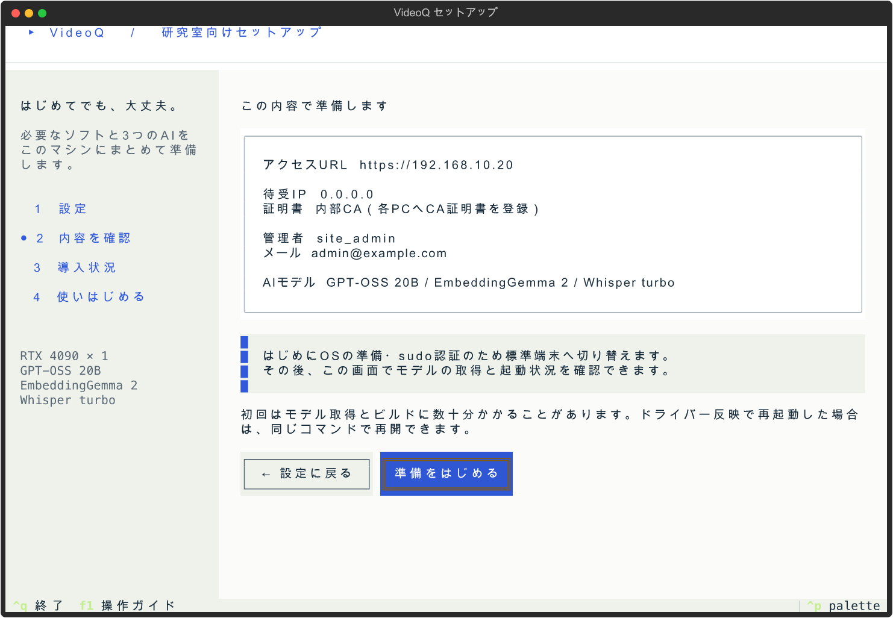

# VideoQ Textual setup preview

Design: VideoQ's existing blue (`#3159dc`), white cards, sage background and navy text. Heading, form-label and step-navigation concepts reference the user's [shadcn-digital-agency-jp](https://github.com/yukiharada1228/shadcn-digital-agency-jp) project. This is a native Textual interface, not embedded React.

These are **preview-mode** screens with example account and LAN values. No server was provisioned to generate them.

| Screen | Preview |
|---|---|
| Settings | [PNG](01-settings.png) / [SVG](01-settings.svg) |
| Review | [PNG](02-review.png) / [SVG](02-review.svg) |
| Progress | [PNG](03-progress.png) / [SVG](03-progress.svg) |
| Finished | [PNG](04-finished.png) / [SVG](04-finished.svg) |

Rendered using Textual 8.2.8's headless test driver at 120×40, then exported to SVG and rendered to PNG with resvg. CJK `textLength` in the Rich SVG export is corrected to terminal cell width so Japanese remains readable in the artifact; the runtime interface is unchanged. An additional headless test exercises 80×24 keyboard navigation and the compact layout.

OS setup and sudo authentication deliberately use the standard terminal through Textual's suspend/resume API. Public release downloads and signature verification need no GitHub account or CLI. Backend provisioning runs as the normal operator user; sudo is noninteractive during captured progress. First passwords are masked, cleared after submission, and sent directly to the verified own-origin API without command-line arguments or log output.

A fresh Ubuntu installation including a physical driver reboot has not been tested through the TUI. Existing core installation and isolated gateway TLS verification are documented separately.
